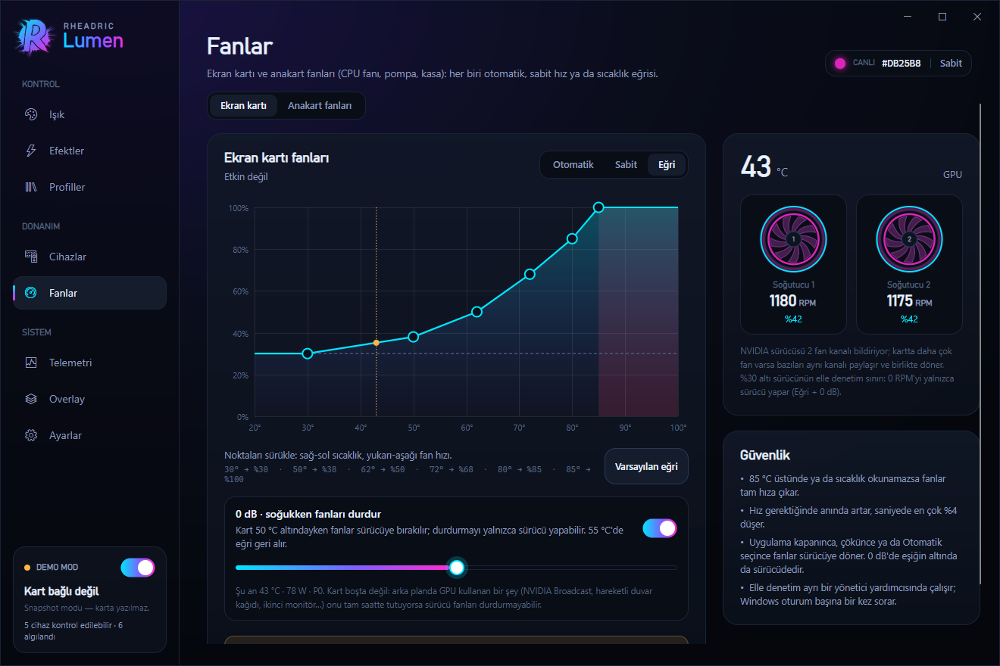
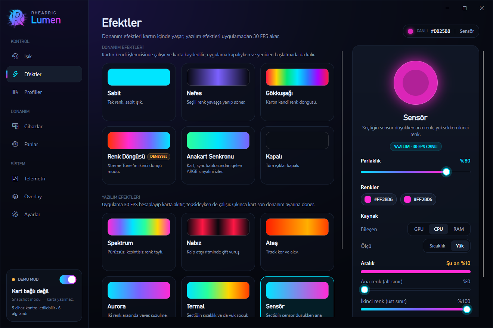
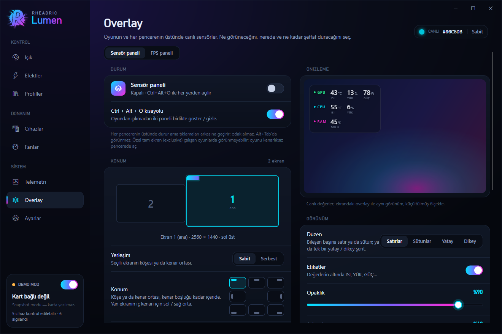
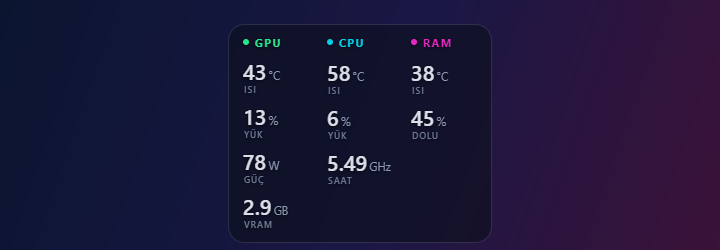
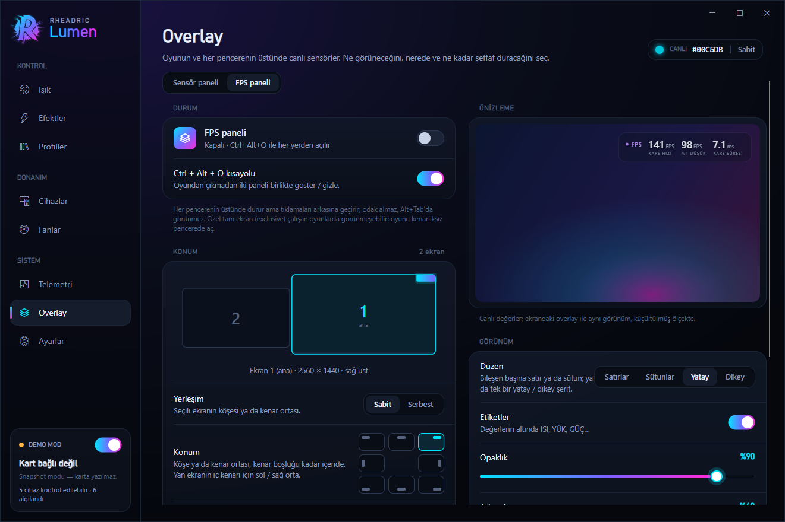
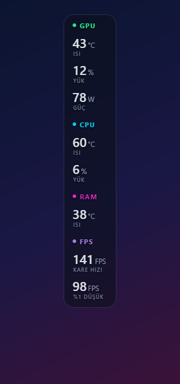

<div align="center">


# Rheadric Lumen

**Control the lighting of GALAX RTX 50 graphics cards without Xtreme Tuner, plus your keyboard,
mouse, motherboard and RAM lighting, your GPU fans, CPU fan, pump and case fans, from one window,
with a sensor and FPS overlay on top of your game.**

*Formerly "ARGB Controller for Galax".*

<a href="https://github.com/rheadricc/ARGB-Controller-for-Galax/releases/download/v2.0.0/Rheadric-Lumen-v2.0.0-win64.zip"></a>


</div>

---

## Download

**The program is right here in this repository:** `RheadricLumen.exe` plus the three DLLs next to it
(Avalonia's renderer: `libSkiaSharp.dll`, `libHarfBuzzSharp.dll`, `av_libglesv2.dll`). Get it either way:

1. the green **Download** button above →
   [`Rheadric-Lumen-v2.0.0-win64.zip`](https://github.com/rheadricc/ARGB-Controller-for-Galax/releases/download/v2.0.0/Rheadric-Lumen-v2.0.0-win64.zip) (~15.8 MB), or
2. the green **`<> Code`** button at the top of this page → **Download ZIP**.

Then **extract the zip** (right-click → *Extract All…*), move the **Rheadric Lumen** folder somewhere permanent
(for example `%LOCALAPPDATA%\Programs\Rheadric Lumen`) and double-click `RheadricLumen.exe`.
Keep the four files together. Older versions and release notes: [Releases](https://github.com/rheadricc/ARGB-Controller-for-Galax/releases).

> **Nothing else to install for the app itself.** It's a native Windows program; the .NET runtime is not needed.
> Only RAM lighting, motherboard fans and CPU/RAM temperatures need a driver (PawnIO), see [RAM lighting](#ram-lighting).

> **Windows SmartScreen warning?** The exe is not digitally signed yet, so Windows shows
> *"Windows protected your PC"* on first run. Click **More info → Run anyway**.

> **The interface is in Turkish.** The labels used below are given in Turkish with a translation.

> **Coming from ARGB Controller for Galax?** Quit the old app (tray → **Çıkış**) and start this one: your colors,
> profiles, favorites and the "start with Windows" setting are carried over. You can delete the old exe afterwards.

---

## What it does

GALAX cards ship with Xtreme Tuner for their RGB. This app talks to the card's RGB controller
directly through the NVIDIA driver instead, and while it's at it, drives the other lit hardware
in your PC, the GPU fans and every fan on the motherboard.

| | |
|---|---|
| 🎨 **Card lighting** | Color wheel, HEX input, 8 base colors, a custom slot and favorites. Brightness 0–100 |
| ✨ **Hardware effects** | Static, Breathing, Rainbow, Color cycle, Motherboard sync, Off. They run on the card itself and stay after a reboot, even with the app closed |
| 🌈 **Software effects** | Spectrum, Pulse, Fire, Aurora, Thermal, Sensor, Music (reacts to what you hear), streamed at 30 FPS from the tray. Thermal (cool → hot) and Sensor (one color → the other) follow the reading you pick: GPU, CPU or RAM, temperature or load, over a range you set |
| ⌨️ **Other devices** | Finds your keyboard, mouse, motherboard and RAM lighting on start. Color one, several or all of them at once; each keeps its own setting |
| 🌀 **GPU fans** | Auto (driver), Fixed % or a drag-to-edit temperature curve, with live RPM. **0 dB** on the curve: below a temperature you set the fans are handed back to the driver, the only one that can stop them |
| 🌬️ **Motherboard fans** | CPU fan, pump and system fan headers (MSI 400–700 series boards with the Nuvoton NCT6687D), **each on its own**: Auto (BIOS), Fixed % or a curve that follows the CPU, the GPU or whichever is hotter. Copy one header's setting to all case fans, live RPM and board temperatures |
| 🛡️ **Fan safety** | GPU fans: 100 % above 85 °C or if the sensor can't be read. Motherboard fans: 100 % above CPU 95 °C / GPU 85 °C or without a reading; never below 20 % (case), 25 % (CPU fan) or 50 % (pump); a fan that reads 0 RPM for 5 s goes back to the BIOS. All fans go back to the driver / BIOS when you pick Auto, quit, or the app crashes |
| 💾 **Profiles** | 6 ready-made looks; save, overwrite and delete your own |
| 📈 **Telemetry** | GPU temperature, load, power, fan, clocks and VRAM; CPU load and clock, RAM use. Optional CPU and DDR5 temperatures (read only) |
| 🖥️ **Overlay** | A sensor panel on top of your game and every window: pick from 15 readings, rows, columns or a horizontal / vertical strip, opacity, background, size. **Any monitor:** pick the screen on a map, use one of 8 fixed spots or **drag it** wherever you like; it snaps to the margins and the middle. Clicks pass through it; temperatures turn amber / red near their limits. **Ctrl+Alt+O** shows and hides it |
| 🎮 **FPS** | Frame rate, 1 % low and frame time of the game in front, read from the same Windows events PresentMon uses. Add them to the sensor panel or show them as a separate **FPS panel** with its own spot and look |
| ⚡ **Quick control** | Tray menu with colors, effects, profiles, the overlay and moving it, **Ctrl+Alt+L** toggles all lights from anywhere, optional start with Windows, command line |

| Devices | Fan curve | 0 dB | Motherboard fans |
|---|---|---|---|
|  |  |  |  |

| Effects | Sensor effect (CPU load) | Profiles | Telemetry |
|---|---|---|---|
|  |  |  |  |

| Overlay settings | Placed freely on a side screen | On screen (strip, no background) | On screen (columns) |
|---|---|---|---|
|  |  |  |  |

| FPS panel settings | FPS panel on screen | Vertical strip (with FPS) |
|---|---|---|
|  |  |  |

---

## Supported hardware

### Graphics cards

| Card | Status |
|---|---|
| GALAX GeForce RTX 5080 1-Click OC 3X | Tested on a real card |
| GALAX GeForce RTX 5070 Ti EX Gamer 1-Click OC | Added from known IDs, not tested yet |

If your card isn't recognised the app **writes nothing to it** and shows the card in demo mode;
the other devices and the fan page still work. Fan control uses the NVIDIA driver and has only been
tested on the RTX 5080 above. Have another GALAX RTX 50 card?
[Open an issue](https://github.com/rheadricc/ARGB-Controller-for-Galax/issues) with its exact model name.

### Other devices

| Device | How | Notes |
|---|---|---|
| ASUS ROG Strix Scope TKL keyboard | USB, Aura direct mode | Tested, keys and underglow. The color lives in the keyboard's memory, nothing is saved to it permanently |
| SteelSeries Aerox 3 Wireless mouse | SteelSeries GG (GameSense) | Tested. **SteelSeries GG must be running**; the mouse returns to your GG setting when the app quits |
| MSI Mystic Light motherboards (`0DB0:0076`, e.g. X670E Gaming Plus WiFi) | USB | Tested. JRGB, JARGB and onboard LEDs; nothing is saved to the board permanently |
| RAM with an ENE RGB controller (`AUDA0-E6K5-0101`), e.g. G.Skill DDR5 `F5-6000J3038F16G` | SMBus, through [PawnIO](https://pawnio.eu) | Tested on AMD (X670E). Needs the PawnIO driver and administrator permission, see below |
| SteelSeries Arctis 9 | | Listed; it has no RGB |

Keyboard, mouse, motherboard and RAM only accept a static color, so animated effects on them are drawn
frame by frame by the app and only run while it's open (it keeps running in the tray).

### RAM lighting

RAM lighting sits on the motherboard's SMBus, which Windows only lets a kernel driver reach. Rheadric Lumen
doesn't ship its own driver; it uses **[PawnIO](https://pawnio.eu)**, the signed open-source driver that
OpenRGB and LibreHardwareMonitor use too.

1. Install PawnIO once: [PawnIO_setup.exe](https://github.com/namazso/PawnIO.Setup/releases/latest) (from its author's GitHub).
2. Start Rheadric Lumen, open **Cihazlar** *(Devices)*, press **Renk ver** *(Set color)* on the RAM card and pick a color.
3. Windows asks for administrator permission **once per app start**: the RAM writes run in a small helper
   process (`RheadricLumen.exe --ram-host`) that exits together with the app.

What it does and doesn't do, on purpose:

- It only ever writes to the RGB controllers (SMBus `0x70`–`0x77`), and only ones that answer with the ENE signature
  and a controller version tested on real modules. The modules' SPD hubs (`0x50`–`0x57`) can only be *read*, and only
  the six registers needed for the temperature sensor; the helper refuses every other transfer to them.
- Every transfer takes the same system-wide SMBus lock that MSI Center, OpenRGB and HWiNFO use, so it doesn't
  collide with them.
- It writes colors and the "direct" switch only. Nothing is saved to the modules and their address is never
  changed: a full power-off brings back their own lighting.
- **Bırak** *(Release)* writes the colors the modules had before the app first touched them.
- With **MSI Center** running, take the RAM out of Mystic Light's sync, or both programs will write to it.

Without PawnIO the RAM is listed, but not written.

### Motherboard fans

The same PawnIO driver (its signed `LpcIO` module) lets the app reach the motherboard's fan chip. Supported: MSI
400–700 series boards with the **Nuvoton NCT6687D** (for example X570, B650, X670E). MSI's 800 series uses a different
chip revision and is refused.

1. Open **Fanlar → Anakart fanları** *(Fans → Motherboard fans)*. This turns on the hardware sensors (one
   administrator prompt per app start, the same helper as the RAM).
2. Pick a fan in the list on the right (CPU fan, pump or a case fan), then **Otomatik** *(Auto, the BIOS curve)*,
   **Sabit** *(Fixed)* or **Eğri** *(Curve)* and which temperature its curve follows. Every fan keeps its own setting;
   one button copies it to all case fans.

- The CPU fan never goes below 25 % and the pump below 50 %; if the CPU temperature can't be read, both run at 100 %.
- A fan that reads 0 RPM for 5 seconds while the app drives it goes back to the BIOS until you change its setting.
- If the app quits, crashes or stops asking for 10 seconds, the fans go back to the BIOS. If the helper itself is
  killed, the next one puts them back before anything else.
- Settings from the previous version (one mode for all case fans) are carried over to each case fan; the CPU fan and
  the pump start on Auto.
- A fan whose speed doesn't change is not PWM-controlled (3-pin, or on a hub). If **MSI Center**'s fan control is
  on, it will fight the app for the same headers: leave the fans on **Otomatik** *(Auto)* in one of them.

---

## How to use it

1. **Işık** *(Light)*: under **Hedef cihaz** *(Target device)* pick **Tümü** *(All)* or the devices you
   want, then choose a color. It's applied immediately.
2. **Efektler** *(Effects)*: pick an animation and its speed.
3. **Cihazlar** *(Devices)*: everything that was found, what can be controlled and why.
   **Renk ver** *(Set color)* takes a device over, **Tanımla** *(Identify)* flashes it,
   **Bırak** *(Release)* hands it back to its own software.
4. **Fanlar** *(Fans)*: **Otomatik** *(Auto)*, **Sabit** *(Fixed)* or **Eğri** *(Curve)*, then
   **Etkinleştir** *(Enable)*. Windows asks for administrator permission once, because the NVIDIA driver
   only accepts fan speeds from an elevated process. **Anakart fanları** *(Motherboard fans)* at the top switches to
   the motherboard's fans (see [Motherboard fans](#motherboard-fans)).
5. **Overlay**: turn on the sensor panel or the **FPS paneli** *(FPS panel)*, pick readings, layout and spot.
   FPS and CPU/RAM temperatures need the hardware sensors (one administrator prompt per app start).
6. Closing the window keeps the app in the tray. To quit: tray icon → **Çıkış** *(Exit)*.

A newly found device is never touched until you give it a color yourself.

### Good to know

- **Xtreme Tuner, OpenRGB, Armoury Crate, MSI Center and GG can stay installed**, but if two programs
  write to the same device the last one wins. Armoury Crate re-applies its own keyboard effect when it
  switches profiles; MSI Center loads its own motherboard profile when it starts.
- **One color for the whole card.** The GALAX controller drives all three fans and the side light from a
  single color, so the Fan 1/2/3 selection still colors every fan. The app tells you when that happens.
- The preview of hardware animations in the window is an approximation; the card itself can't be read back.
- **GPU fans can't go below 30 %** when the app sets their speed (an NVIDIA limit), and only the driver can stop
  them: 0 dB hands them back to it, and it stops them only when the card is really idle.
- **FPS of windowed Vulkan/OpenGL games on Windows 10** may not show up: their frames are presented by a system
  process, not the game (PresentMon has the same limit). Direct3D games and full-screen games are measured.

---

## Command line

```text
RheadricLumen.exe "#00E5FF" --brightness 60     static color (saved to the card)
RheadricLumen.exe --effect aurora --speed 30    effect: static, breathing, rainbow, cycle, sync, off,
                                                spectrum, pulse, fire, aurora, thermal, load, audio
RheadricLumen.exe --profile "Neon Gece"         apply a profile
RheadricLumen.exe off | on | toggle             lights off / on / toggle
RheadricLumen.exe --overlay on|off|toggle       sensor overlay (starts the app in the tray if needed)
RheadricLumen.exe --sensors                     print every sensor once (CPU/RAM temperatures ask for admin)
RheadricLumen.exe --fps [seconds]               print the frame rate of every app drawing to the screen (5 s; asks for admin)
RheadricLumen.exe --exit                        close the running app cleanly
RheadricLumen.exe --list | --help
```

If the app is already running the command is passed to it and goes to the devices picked on the Light page.
In PowerShell add `| Out-Host` to see the output.

---

## Uninstall

1. **Ayarlar** *(Settings)* → turn **Windows ile başlat** *(Start with Windows)* off.
2. Tray icon → **Çıkış** *(Exit)*. Fans go back to driver control automatically.
3. Delete the **Rheadric Lumen** folder and the settings folder `%APPDATA%\RheadricLumen`.
4. If you installed PawnIO only for this app, remove it from *Settings → Apps* like any other program.

The app itself installs no drivers and no services. If you already deleted the exe while autostart was on,
remove the `RheadricLumen` value under `HKEY_CURRENT_USER\Software\Microsoft\Windows\CurrentVersion\Run`.

---

## FAQ

**Can this damage my card?**
It doesn't touch the card's firmware or BIOS. It writes the same RGB controller registers as Xtreme Tuner.
Repeated color changes (for example dragging the color wheel) are batched before anything is saved, and
software effects are never saved to the card at all.

**Can this damage my RAM?**
The known way RGB tools have hurt RAM is by writing to the wrong SMBus device (the SPD chip) or racing another
program on the bus. The RAM helper can't address the SPD range at all, takes the shared SMBus lock, refuses
controller versions it wasn't tested with, and never saves anything to the modules.
See [RAM lighting](#ram-lighting).

**Is fan control safe?**
The safety rules run in the elevated fan helper itself, not in the window: 100 % above 85 °C or without a
temperature reading, a slow ramp down, and automatic driver control again when you choose Auto, quit or the
app crashes. The fans never go below the driver's own minimum. A log is kept in `%APPDATA%\RheadricLumen\fanhost.log`.

Motherboard fans follow the same idea in the RAM helper: 100 % above CPU 95 °C / GPU 85 °C or without a reading,
never below 20 % (case fans), 25 % (CPU fan) or 50 % (pump), a stopped fan goes back to the BIOS, and all of them
go back to the BIOS when you choose Auto, quit, or the app crashes. Log: `%APPDATA%\RheadricLumen\ramhost.log`.

**Does it need to run all the time?**
Only for software effects, animated effects on the keyboard/mouse/motherboard/RAM, and fan modes other than Auto.
Hardware effects on the card stay after the app is closed; RAM, keyboard and motherboard keep their last color
until the PC is switched off.

**My mouse isn't listed.**
Start SteelSeries GG first, then press **Yeniden tara** *(Rescan)* on the Devices page.

---

## Privacy

No internet access, no telemetry, no update checks. The only network traffic is to SteelSeries GG's local
GameSense server on your own PC (`127.0.0.1`), and only when a SteelSeries device is in use.

---

## License

Free for personal use. Redistribution, resale and reverse engineering are not permitted:
see [LICENSE.txt](LICENSE.txt). Credits and third-party notices: [THIRD-PARTY-NOTICES.txt](THIRD-PARTY-NOTICES.txt).

GALAX is a trademark of GALAX (Galaxy Microsystems Ltd.). NVIDIA and GeForce are trademarks of NVIDIA Corporation.
ASUS, ROG, Aura and Armoury Crate are trademarks of ASUSTeK Computer Inc. MSI, Mystic Light and MSI Center are
trademarks of Micro-Star International. SteelSeries, GG and GameSense are trademarks of SteelSeries ApS.
G.Skill is a trademark of G.Skill International. This project is not affiliated with any of them.

---

## Türkçe

GALAX RTX 50 serisi ekran kartlarının ışıklarını **Xtreme Tuner olmadan** yöneten bir Windows uygulaması.
Aynı pencereden klavye, mouse, anakart ve RAM ışıklarını da değiştirir, ekran kartı, CPU fanı, pompa ve kasa fanlarına
sabit hız ya da sıcaklık eğrisi verir, oyunun üstünde sensör ve FPS paneli gösterir. Arayüz Türkçedir. (Eski adı: ARGB
Controller for Galax.)

- **İndir:** yukarıdaki yeşil **Download** düğmesi → zip'i çıkar → **Rheadric Lumen** klasöründeki `RheadricLumen.exe`.
  Kurulum ve .NET gerekmez; exe'nin yanındaki 3 DLL'i birlikte tut.
- *"Windows bilgisayarınızı korudu"* uyarısı çıkarsa: **Ek bilgi → Yine de çalıştır** (exe henüz imzalı değil).
- Eski sürümden geçiyorsan: eskisini tepsiden kapat, bunu aç; renkler, profiller ve "Windows ile başlat" taşınır.
- Fan modları (Sabit / Eğri) ilk kullanımda bir kez yönetici izni ister. 85 °C üstünde ya da sensör okunamazsa
  fanlar %100'e çıkar; uygulama kapanınca ya da çökünce fanlar sürücüye geri döner. Eğride **0 dB**: kart eşiğin
  altındayken fanlar sürücüye bırakılır (NVIDIA elle en az %30'a izin verir, durdurmayı yalnızca sürücü yapar).
- **Anakart fanları** (Fanlar → Anakart fanları): NCT6687D'li MSI anakartlarda (400–700 serisi) CPU fanı, pompa ve her kasa
  fanı ayrı ayrı: Otomatik (BIOS), sabit hız ya da CPU/GPU sıcaklığına göre eğri. CPU fanı en az %25, pompa en az %50;
  5 sn 0 RPM okuyan fan BIOS'a döner. PawnIO gerekir; uygulama kapanınca fanlar BIOS'a döner. MSI Center'ın fan
  ayarıyla aynı anda kullanma.
- **FPS:** ön plandaki oyunun FPS'i, %1 düşük ve kare süresi; sensör paneline eklenir ya da ayrı FPS paneli olur
  (bir kez yönetici izni). Windows 10'da pencere modundaki Vulkan/OpenGL oyunları ölçülemeyebilir.
- **Efektler:** Termal ve Sensör efektleri GPU, CPU ya da RAM'in sıcaklığını veya yükünü izler; aralığı sen seçersin.
- **RAM ışığı** için bir kez [PawnIO](https://pawnio.eu) kurulmalı (OpenRGB'nin de kullandığı imzalı sürücü).
  Uygulama her açılışta RAM'e ilk renk verişte bir kez yönetici izni ister. Yalnızca RGB denetleyicisinin adreslerine
  (0x70–0x77) yazar; SPD'den yalnızca sıcaklık okur, MSI Center'la aynı SMBus kilidini kullanır, modüllere kalıcı bir şey kaydetmez.
- **Overlay:** Overlay sayfasından aç ya da **Ctrl+Alt+O**. Göstergeleri, düzeni (satır, sütun, yatay/dikey şerit) ve şeffaflığı seç; tıklamalar
  arkasındaki oyuna geçer. Yerini değiştirmek için ekran haritasından monitörü seç ve sabit bir konum işaretle, ya da
  **Taşı**'ya bas, overlay'i istediğin ekrana sürükle ve **Bitti** de. CPU/RAM sıcaklığı için Telemetri'deki sensör
  anahtarını aç (bir kez yönetici izni).
  MSI Center açıksa Mystic Light'ta RAM'i senkrondan çıkar.
- Kaldırmak için: Ayarlar → "Windows ile başlat" kapat → tepsiden Çıkış → **Rheadric Lumen** klasörünü ve
  `%APPDATA%\RheadricLumen` klasörünü sil.

© 2026 Batuhan Çakır (Rheadric)
