<div align="center">


# Rheadric Lumen v2.0.1

**All the lighting and fans in your PC, from one window.**

Graphics card, keyboard, mouse, motherboard and RAM lighting · GPU fans, CPU fan, pump and case fans ·
live sensors and an FPS overlay on top of your game. One small native app instead of a stack of vendor tools.

**English** · [Türkçe](#turkce)

<a href="https://github.com/rheadricc/RheadricLumen/releases/download/v2.0.1/Rheadric-Lumen-v2.0.1-win64.zip"></a>


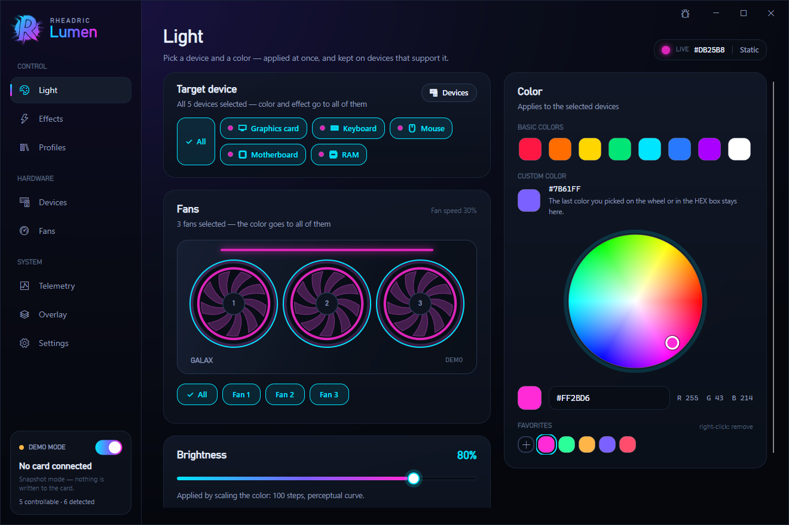

</div>

<a name="english"></a>

## Contents

[Download](#download) · [Requirements](#requirements) · [What it does](#what-it-does) · [Screenshots](#screenshots) ·
[Supported hardware](#supported-hardware) · [How to use it](#how-to-use-it) · [Command line](#command-line) ·
[Uninstall](#uninstall) · [FAQ](#faq) · [Privacy](#privacy) · [License](#license)

---

## Download

**The program is right here in this repository:** `RheadricLumen.exe` plus the three DLLs next to it
(the renderer: `libSkiaSharp.dll`, `libHarfBuzzSharp.dll`, `av_libglesv2.dll`). Get it either way:

1. the green **Download** button above →
   [`Rheadric-Lumen-v2.0.1-win64.zip`](https://github.com/rheadricc/RheadricLumen/releases/download/v2.0.1/Rheadric-Lumen-v2.0.1-win64.zip) (~15.8 MB), or
2. the green **`<> Code`** button at the top of this page → **Download ZIP**.

Then **extract the zip** (right-click → *Extract All…*), move the **Rheadric Lumen** folder somewhere permanent
(for example `%LOCALAPPDATA%\Programs\Rheadric Lumen`) and double-click `RheadricLumen.exe`.
Keep the four files together. Older versions and release notes: [Releases](https://github.com/rheadricc/RheadricLumen/releases).

> **Windows SmartScreen warning?** The exe is not digitally signed yet, so Windows shows
> *"Windows protected your PC"* on first run. Click **More info → Run anyway**.

> **Updating?** Quit the old version (tray icon → **Exit**) and start the new one: colors, profiles, favorites,
> fan settings and "Start with Windows" are carried over. Coming from 2.0.0 or older, the interface stays in Turkish;
> switch it in **Settings → Language**. The app was called *ARGB Controller for Galax* before 2.0.

---

## Requirements

| | |
|---|---|
| **Windows 10 or 11, 64-bit** | Required. |
| **Nothing else for the app itself** | No installer, no .NET runtime, no Visual C++ redistributable: it's a native Windows program. |
| **NVIDIA graphics driver** | For the graphics card's lighting, GPU fans and GPU readings. Any recent GeForce driver. |
| **[PawnIO](https://pawnio.eu)** *(free, signed driver, optional)* | Only for **RAM lighting**, **motherboard fans** and **CPU / RAM temperatures**. Install it once: [PawnIO_setup.exe](https://github.com/namazso/PawnIO.Setup/releases/latest). It isn't bundled; it's the same driver OpenRGB and LibreHardwareMonitor use. |
| **SteelSeries GG** *(optional)* | Only for SteelSeries mouse lighting; it must be running. |

Windows asks for **administrator permission** only when a feature needs it: GPU fan modes other than Auto,
and the hardware helper (RAM lighting, motherboard fans, CPU/RAM temperatures, FPS), once per app start.
Lighting, profiles, effects and the overlay work without it.

---

## What it does

Each part of your PC usually comes with its own app: the graphics card with one, the keyboard with another, the
motherboard with a third, and the fans with their BIOS. Rheadric Lumen talks to the hardware directly and puts it all
in one window: pick the devices, pick a color or an effect, set the fans, and keep an eye on the sensors in game.

### Lighting

| | |
|---|---|
| 🎨 **Every device at once** | Graphics card, keyboard, mouse, motherboard and RAM: color one, several or **All**. Each device keeps its own setting, and a newly found device is never touched until you give it a color |
| 🌈 **Colors** | Color wheel, HEX input, 8 base colors, a custom slot and favorites. Brightness 0–100 |
| ✨ **Effects** | **Software effects** run on every selected device: Spectrum, Pulse, Fire, Aurora, Thermal, Sensor and Music (reacts to what you hear). Thermal and Sensor follow a reading you pick (GPU, CPU or RAM, temperature or load) over a range you set. **Hardware effects** (Static, Breathing, Rainbow, Color cycle, Motherboard sync, Off) run on the graphics card itself and stay after a reboot, even with the app closed |
| 💾 **Profiles** | 6 ready-made looks; save, overwrite and delete your own |

### Fans

| | |
|---|---|
| 🌀 **Graphics card fans** | Auto (driver), Fixed % or a drag-to-edit temperature curve, with live RPM. **0 dB**: below a temperature you set the fans are handed back to the driver, the only one that can stop them |
| 🌬️ **Motherboard fans** | CPU fan, pump and every system fan header, **each on its own**: Auto (BIOS), Fixed % or a curve that follows the CPU, the GPU or whichever is hotter. Copy one header's setting to all case fans; live RPM and board temperatures |
| 🛡️ **Safety first** | 100 % above GPU 85 °C / CPU 95 °C or if a temperature can't be read. Never below 20 % (case), 25 % (CPU fan) or 50 % (pump). A fan that reads 0 RPM for 5 s goes back to the BIOS. Every fan goes back to the driver / BIOS when you pick Auto, quit, or the app crashes |

### Sensors and overlay

| | |
|---|---|
| 📈 **Telemetry** | GPU temperature, load, power, fan, clocks and VRAM; CPU load and clock, RAM use. CPU (AMD Ryzen) and DDR5 temperatures, read only |
| 🖥️ **Sensor overlay** | A panel on top of your game and every window: pick from 15 readings; rows, columns or a horizontal / vertical strip; opacity, background, size. **Any monitor:** pick the screen on a map, use one of 8 fixed spots or **drag it** anywhere; it snaps to the margins and the middle. Clicks pass through it; temperatures turn amber / red near their limits. **Ctrl+Alt+O** shows and hides it |
| 🎮 **FPS** | Frame rate, 1 % low and frame time of the game in front, read from the same Windows events PresentMon uses. Add them to the sensor panel or show a separate **FPS panel** with its own spot and look |

### Everyday

| | |
|---|---|
| ⚡ **Quick control** | Tray menu with colors, effects, profiles and the overlay; **Ctrl+Alt+L** toggles every light from anywhere; optional start with Windows; [command line](#command-line) |
| 🌍 **English / Türkçe** | Starts in English; **Settings → Language** switches the whole interface at once, tray menu and overlay included |
| 🔒 **Offline** | No account, no internet, no telemetry, no update checks |

---

## Screenshots

| Devices | Effects | Sensor effect (CPU load) | Profiles |
|---|---|---|---|
| 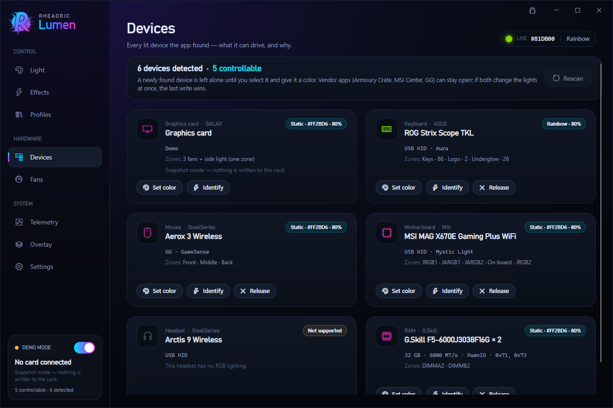 | 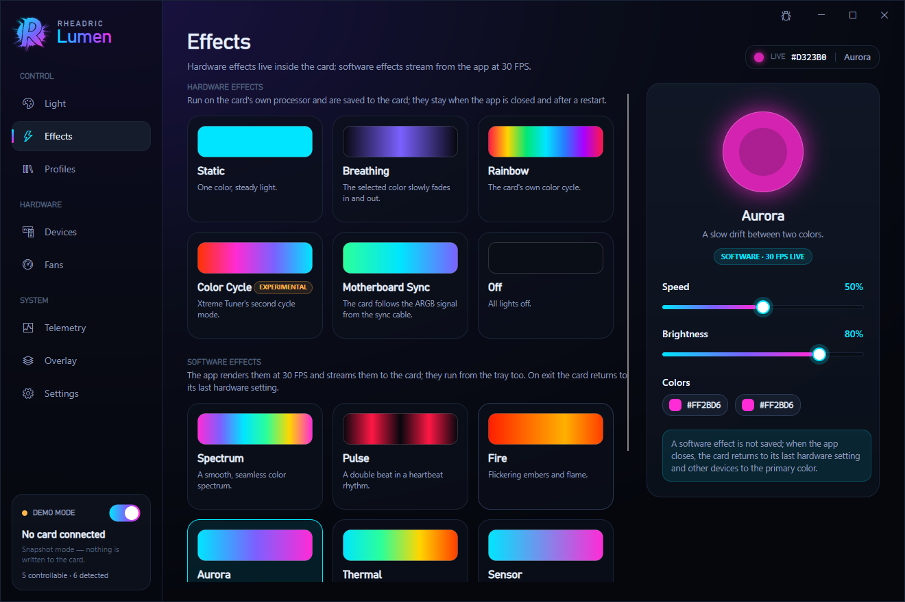 | 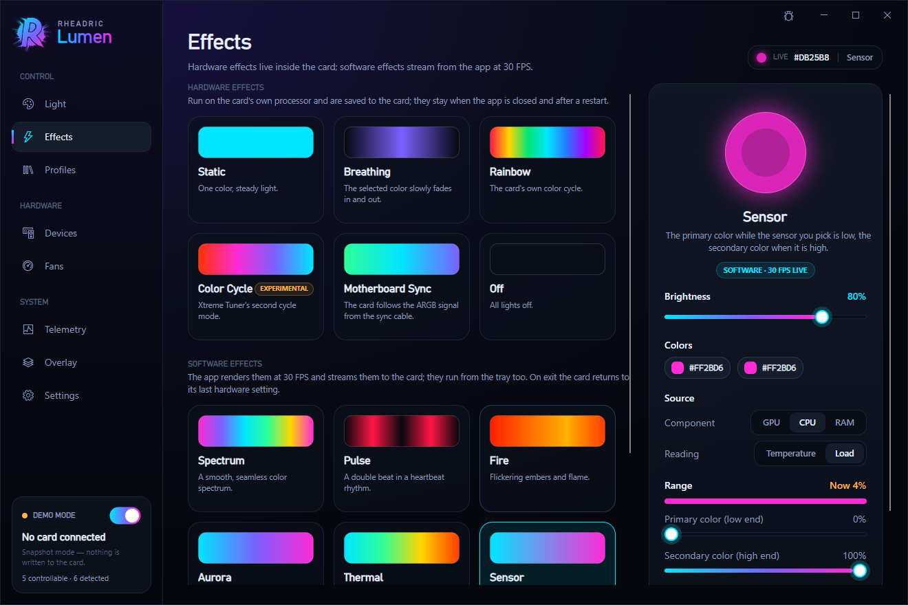 | 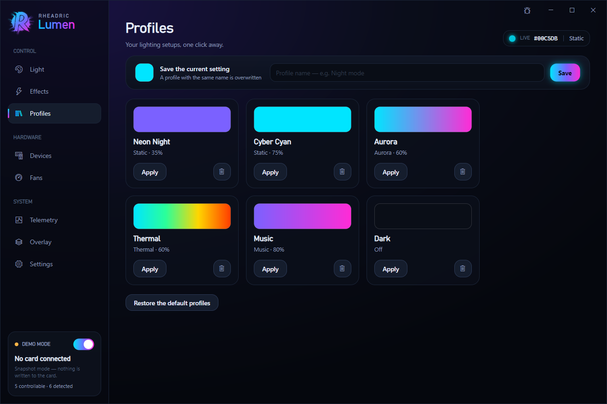 |

| Graphics card fan curve | 0 dB | Motherboard fans | Telemetry |
|---|---|---|---|
| 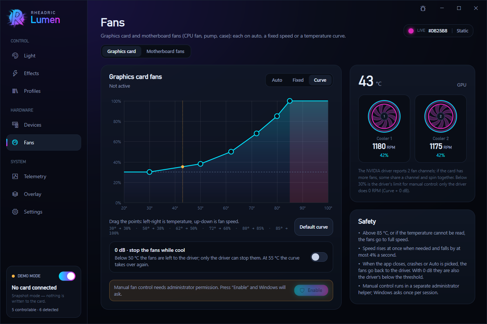 | 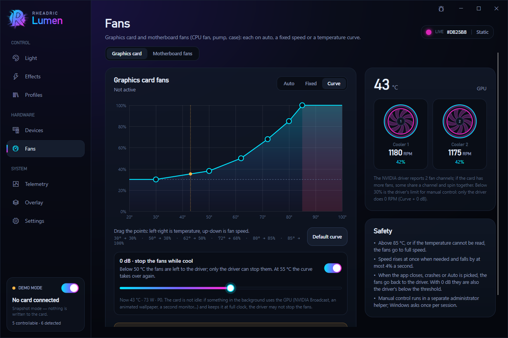 | 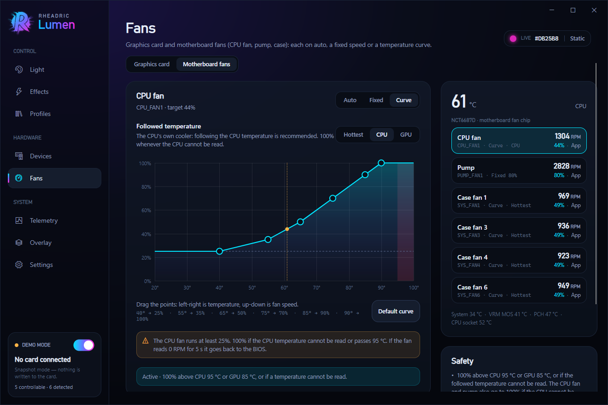 | 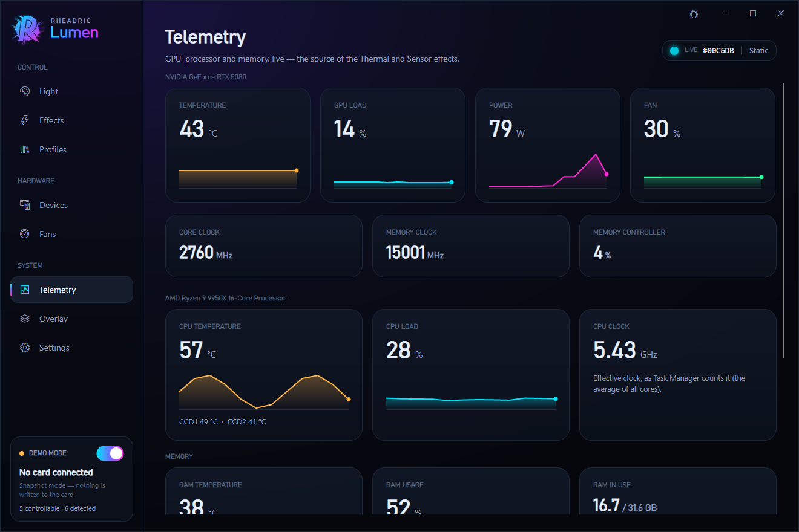 |

| Overlay settings | Placed freely on a side screen | On screen (strip, no background) | On screen (columns) |
|---|---|---|---|
|  | 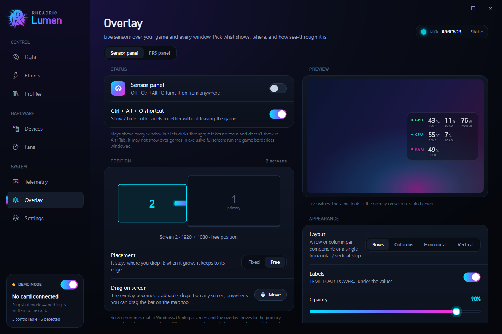 |  | 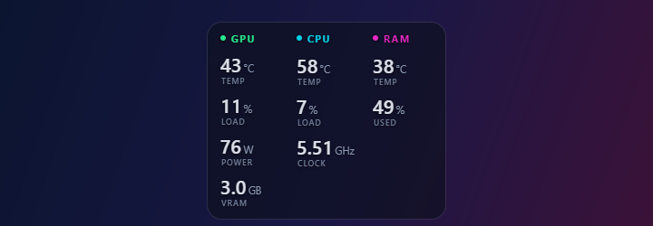 |

| FPS panel settings | FPS panel on screen | Vertical strip (with FPS) | Settings and language |
|---|---|---|---|
| 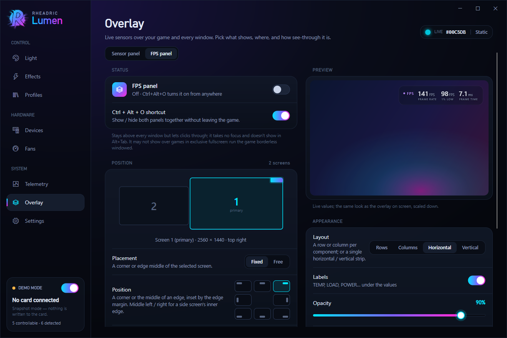 |  | 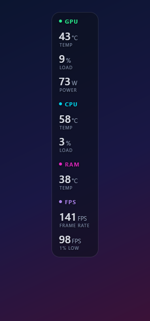 | 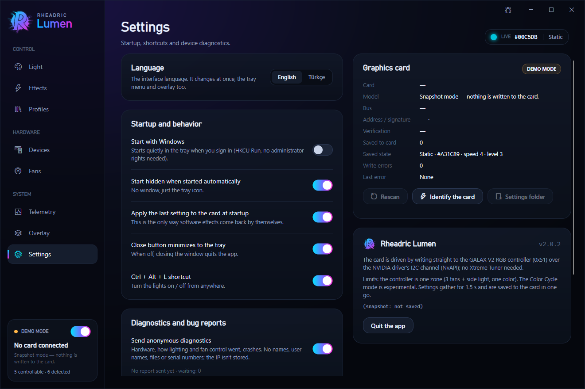 |

---

## Supported hardware

What's below has been tested on real hardware unless it says otherwise. Have something else?
[Open an issue](https://github.com/rheadricc/RheadricLumen/issues) with its exact model name.

### Lighting

| Device | How | Notes |
|---|---|---|
| **GALAX GeForce RTX 5080** 1-Click OC 3X | NVIDIA driver (the card's RGB controller over I²C) | Tested. Replaces Xtreme Tuner for the lighting |
| **GALAX GeForce RTX 5070 Ti** EX Gamer 1-Click OC | same | Added from known IDs, not tested yet |
| **ASUS ROG Strix Scope TKL** keyboard | USB, Aura direct mode | Tested, keys and underglow. Nothing is saved to the keyboard permanently |
| **SteelSeries Aerox 3 Wireless** mouse | SteelSeries GG (GameSense) | Tested. **GG must be running**; the mouse returns to your GG setting when the app quits |
| **MSI Mystic Light** motherboards (`0DB0:0076`, e.g. X670E Gaming Plus WiFi) | USB | Tested. JRGB, JARGB and onboard LEDs; nothing is saved to the board permanently |
| **RAM** with an ENE RGB controller (`AUDA0-E6K5-0101`), e.g. G.Skill DDR5 `F5-6400J3239G16G` | SMBus, through [PawnIO](https://pawnio.eu) | Tested on AMD (X670E). See [RAM lighting](#ram-lighting) |
| SteelSeries Arctis 9 | | Listed; it has no RGB |

If your graphics card isn't recognised the app **writes nothing to it** and shows it in demo mode; every other
device, the fans and the overlay still work. Keyboard, mouse, motherboard and RAM only accept a static color, so
animated effects on them are drawn frame by frame by the app and run while it's open (it keeps running in the tray).

### Fans

| Fans | How | Notes |
|---|---|---|
| **Graphics card fans** | NVIDIA driver | Tested on the RTX 5080 above |
| **Motherboard fans**: CPU fan, pump, system fans on MSI 400–700 series boards with the **Nuvoton NCT6687D** (e.g. X570, B650, X670E) | Fan chip, through PawnIO | Tested on X670E. MSI's 800 series uses a different chip revision and is refused. See [Motherboard fans](#motherboard-fans) |

### Sensors

GPU readings come from the NVIDIA driver; CPU load and clock and RAM use from Windows, on any PC. CPU temperatures
(AMD Ryzen) and DDR5 module temperatures need PawnIO. FPS works with any game and needs administrator permission.

<a name="ram-lighting"></a>

### RAM lighting

RAM lighting sits on the motherboard's SMBus, which Windows only lets a kernel driver reach. Rheadric Lumen doesn't
ship its own driver; it uses **[PawnIO](https://pawnio.eu)**, the signed open-source driver OpenRGB and
LibreHardwareMonitor use too.

1. Install PawnIO once: [PawnIO_setup.exe](https://github.com/namazso/PawnIO.Setup/releases/latest) (from its author's GitHub).
2. Start Rheadric Lumen, open **Devices**, press **Set color** on the RAM card and pick a color.
3. Windows asks for administrator permission **once per app start**: the RAM writes run in a small helper
   process (`RheadricLumen.exe --ram-host`) that exits together with the app.

What it does and doesn't do, on purpose:

- It only ever writes to the RGB controllers (SMBus `0x70`–`0x77`), and only ones that answer with the ENE signature
  and a controller version tested on real modules. The modules' SPD hubs (`0x50`–`0x57`) can only be *read*, and only
  the six registers needed for the temperature sensor; the helper refuses every other transfer to them.
- Every transfer takes the same system-wide SMBus lock that MSI Center, OpenRGB and HWiNFO use, so it doesn't
  collide with them.
- It writes colors and the "direct" switch only. Nothing is saved to the modules and their address is never
  changed: a full power-off brings back their own lighting.
- **Release** writes the colors the modules had before the app first touched them.
- With **MSI Center** running, take the RAM out of Mystic Light's sync, or both programs will write to it.

Without PawnIO the RAM is listed, but not written.

<a name="motherboard-fans"></a>

### Motherboard fans

The same PawnIO driver (its signed `LpcIO` module) lets the app reach the motherboard's fan chip.

1. Open **Fans → Motherboard fans**. This turns on the hardware sensors (one administrator prompt per app start,
   the same helper as the RAM).
2. Pick a fan in the list on the right (CPU fan, pump or a case fan), then **Auto** (the BIOS curve), **Fixed** or
   **Curve**, and which temperature its curve follows. Every fan keeps its own setting; one button copies it to all
   case fans.

- The CPU fan never goes below 25 % and the pump below 50 %; if the CPU temperature can't be read, both run at 100 %.
- A fan that reads 0 RPM for 5 seconds while the app drives it goes back to the BIOS until you change its setting.
- If the app quits, crashes or stops asking for 10 seconds, the fans go back to the BIOS. If the helper itself is
  killed, the next one puts them back before anything else.
- A fan whose speed doesn't change is not PWM-controlled (3-pin, or on a hub). If **MSI Center**'s fan control is
  on, it will fight the app for the same headers: leave the fans on **Auto** in one of them.

---

## How to use it

1. **Light**: under **Target device** pick **All** or the devices you want, then choose a color. It's applied at once.
2. **Effects**: pick an animation and its speed. Software effects go to every selected device; hardware effects run
   on the graphics card itself.
3. **Devices**: everything that was found, what can be controlled and why. **Set color** takes a device over,
   **Identify** flashes it, **Release** hands it back to its own software, **Rescan** looks again.
4. **Fans → Graphics card**: **Auto**, **Fixed** or **Curve**, then **Enable**. Windows asks for administrator
   permission once, because the NVIDIA driver only accepts fan speeds from an elevated process.
   **Fans → Motherboard fans**: see [Motherboard fans](#motherboard-fans).
5. **Overlay**: turn on the **Sensor panel** or the **FPS panel**, pick readings, layout and spot.
   To place it by hand press **Move**, drag it to any screen and press **Done**.
6. **Profiles**: save the current look under a name and bring it back with **Apply**.
7. **Settings → Language**: **English** or **Türkçe**. The interface, tray menu and overlay switch at once.
8. Closing the window keeps the app in the tray. To quit: tray icon → **Exit**.

### Good to know

- **Vendor apps can stay installed** (Xtreme Tuner, Armoury Crate, MSI Center, SteelSeries GG, OpenRGB), but if two
  programs write to the same device the last one wins. Armoury Crate re-applies its own keyboard effect when it
  switches profiles; MSI Center loads its own motherboard profile when it starts.
- **One color for the whole GALAX card.** Its controller drives all three fans and the side light from a single
  color, so picking Fan 1/2/3 still colors every fan. The app tells you when that happens.
- The preview of hardware animations in the window is an approximation; the card itself can't be read back.
- **GPU fans can't go below 30 %** when the app sets their speed (an NVIDIA limit), and only the driver can stop
  them: 0 dB hands them back to it, and it stops them only when the card is really idle.
- **The overlay may not show over exclusive full-screen games**: run the game borderless windowed.
- **FPS of windowed Vulkan/OpenGL games on Windows 10** may not show up: their frames are presented by a system
  process, not the game (PresentMon has the same limit). Direct3D games and full-screen games are measured.

---

## Command line

```text
RheadricLumen.exe "#00E5FF" --brightness 60     static color (saved to the card)
RheadricLumen.exe --effect aurora --speed 30    effect: static, breathing, rainbow, cycle, sync, off,
                                                spectrum, pulse, fire, aurora, thermal, load, audio
RheadricLumen.exe --profile "Neon Night"        apply a profile
RheadricLumen.exe off | on | toggle             lights off / on / toggle
RheadricLumen.exe --overlay on|off|toggle       sensor overlay (starts the app in the tray if needed)
RheadricLumen.exe --sensors                     print every sensor once (CPU/RAM temperatures ask for admin)
RheadricLumen.exe --fps [seconds]               print the frame rate of every app drawing to the screen (5 s; asks for admin)
RheadricLumen.exe --lang en|tr                  language for this run only (the setting stays as it is)
RheadricLumen.exe --exit                        close the running app cleanly
RheadricLumen.exe --list | --help
```

If the app is already running the command is passed to it and goes to the devices picked on the Light page.
In PowerShell add `| Out-Host` to see the output.

---

## Uninstall

1. **Settings** → turn **Start with Windows** off.
2. Tray icon → **Exit**. Fans go back to driver / BIOS control automatically.
3. Delete the **Rheadric Lumen** folder and the settings folder `%APPDATA%\RheadricLumen`.
4. If you installed PawnIO only for this app, remove it from *Settings → Apps* like any other program.

The app itself installs no drivers and no services. If you already deleted the exe while autostart was on,
remove the `RheadricLumen` value under `HKEY_CURRENT_USER\Software\Microsoft\Windows\CurrentVersion\Run`.

---

## FAQ

**Can this damage my graphics card?**
It doesn't touch the card's firmware or BIOS. It writes the same RGB controller registers as Xtreme Tuner.
Repeated color changes (for example dragging the color wheel) are batched before anything is saved, and
software effects are never saved to the card at all.

**Can this damage my RAM?**
The known way RGB tools have hurt RAM is by writing to the wrong SMBus device (the SPD chip) or racing another
program on the bus. The RAM helper can't address the SPD range at all, takes the shared SMBus lock, refuses
controller versions it wasn't tested with, and never saves anything to the modules. See [RAM lighting](#ram-lighting).

**Is fan control safe?**
The safety rules run in the elevated helpers themselves, not in the window: 100 % when it gets hot or a temperature
can't be read, minimum speeds for the CPU fan and pump, a slow ramp down, and automatic driver / BIOS control again
when you choose Auto, quit or the app crashes. Logs: `%APPDATA%\RheadricLumen\fanhost.log` (graphics card) and
`ramhost.log` (motherboard).

**Does it need to run all the time?**
Only for software effects, animated effects on the keyboard / mouse / motherboard / RAM, fan modes other than Auto
and the overlay. Hardware effects on the graphics card stay after the app is closed; RAM, keyboard and motherboard
keep their last color until the PC is switched off.

**My mouse isn't listed.**
Start SteelSeries GG first, then press **Rescan** on the Devices page.

**How do I switch the language?**
**Settings → Language → English / Türkçe.** It changes at once. A fresh install starts in English.

---

## Privacy

No internet access, no telemetry, no update checks. The only network traffic is to SteelSeries GG's local
GameSense server on your own PC (`127.0.0.1`), and only when a SteelSeries device is in use.

---

## License

Free for personal use. Redistribution, resale and reverse engineering are not permitted:
see [LICENSE.txt](LICENSE.txt). Credits and third-party notices: [THIRD-PARTY-NOTICES.txt](THIRD-PARTY-NOTICES.txt).

GALAX is a trademark of GALAX (Galaxy Microsystems Ltd.). NVIDIA and GeForce are trademarks of NVIDIA Corporation.
ASUS, ROG, Aura and Armoury Crate are trademarks of ASUSTeK Computer Inc. MSI, Mystic Light and MSI Center are
trademarks of Micro-Star International. SteelSeries, GG and GameSense are trademarks of SteelSeries ApS.
G.Skill is a trademark of G.Skill International. This project is not affiliated with any of them.

---

<a name="turkce"></a>

<div align="center">

# Türkçe

**Bilgisayarındaki tüm ışıklar ve fanlar, tek pencereden.**

Ekran kartı, klavye, mouse, anakart ve RAM ışıkları · ekran kartı fanları, CPU fanı, pompa ve kasa fanları ·
oyunun üstünde canlı sensör ve FPS paneli. Bir yığın üretici programı yerine tek, küçük, yerel bir uygulama.

[English](#english) · **Türkçe**

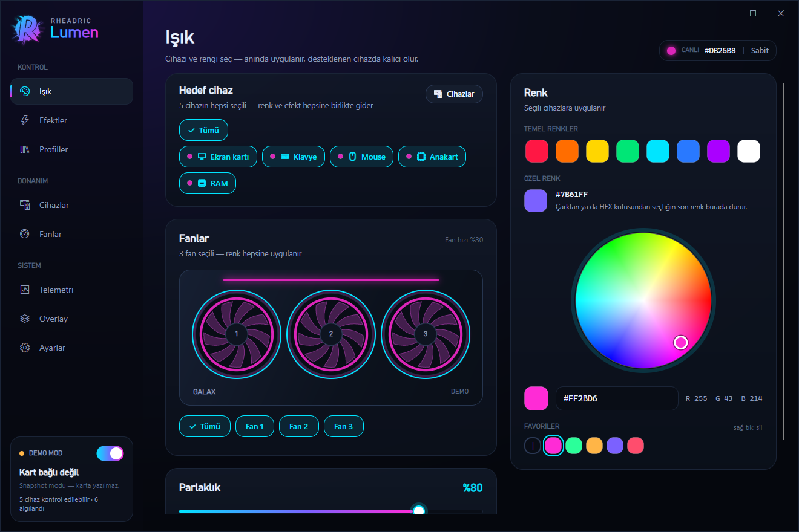

</div>

[İndir](#tr-indir) · [Gereksinimler](#tr-gereksinimler) · [Neler yapar](#tr-neler-yapar) · [Ekran görüntüleri](#tr-ekran) ·
[Desteklenen donanım](#tr-donanim) · [Kullanım](#tr-kullanim) · [Komut satırı](#tr-komut) ·
[Kaldırma](#tr-kaldirma) · [SSS](#tr-sss) · [Gizlilik](#tr-gizlilik) · [Lisans](#tr-lisans)

---

<a name="tr-indir"></a>

## İndir

**Program bu reponun içinde:** `RheadricLumen.exe` ve yanındaki üç DLL (çizim motoru: `libSkiaSharp.dll`,
`libHarfBuzzSharp.dll`, `av_libglesv2.dll`). İki yoldan biriyle al:

1. yukarıdaki yeşil **Download** düğmesi →
   [`Rheadric-Lumen-v2.0.1-win64.zip`](https://github.com/rheadricc/RheadricLumen/releases/download/v2.0.1/Rheadric-Lumen-v2.0.1-win64.zip) (~15.8 MB), ya da
2. sayfanın üstündeki yeşil **`<> Code`** düğmesi → **Download ZIP**.

Sonra **zip'i çıkar** (sağ tık → *Tümünü Ayıkla…*), **Rheadric Lumen** klasörünü kalıcı bir yere taşı
(örneğin `%LOCALAPPDATA%\Programs\Rheadric Lumen`) ve `RheadricLumen.exe`'ye çift tıkla. Dört dosyayı birlikte tut.
Eski sürümler ve sürüm notları: [Releases](https://github.com/rheadricc/RheadricLumen/releases).

> **SmartScreen uyarısı mı çıktı?** Exe henüz dijital olarak imzalı değil; ilk açılışta *"Windows bilgisayarınızı
> korudu"* görünür. **Ek bilgi → Yine de çalıştır**'a bas.

> **Güncelliyor musun?** Eski sürümü kapat (tepsi simgesi → **Çıkış**) ve yenisini aç: renkler, profiller, favoriler,
> fan ayarları ve "Windows ile başlat" taşınır. 2.0.0 ya da daha eskisinden geliyorsan arayüz Türkçe kalır.
> İlk kurulum İngilizce açılır; **Settings → Language → Türkçe** ile değiştir. Uygulamanın 2.0'dan önceki adı
> *ARGB Controller for Galax*'tı.

---

<a name="tr-gereksinimler"></a>

## Gereksinimler

| | |
|---|---|
| **Windows 10 ya da 11, 64 bit** | Gerekli. |
| **Uygulamanın kendisi için başka bir şey gerekmez** | Kurulum yok, .NET yok, Visual C++ paketi yok: yerel bir Windows programı. |
| **NVIDIA ekran kartı sürücüsü** | Ekran kartının ışığı, fanları ve GPU değerleri için. Güncel herhangi bir GeForce sürücüsü. |
| **[PawnIO](https://pawnio.eu)** *(ücretsiz, imzalı sürücü, isteğe bağlı)* | Yalnızca **RAM ışığı**, **anakart fanları** ve **CPU / RAM sıcaklıkları** için. Bir kez kur: [PawnIO_setup.exe](https://github.com/namazso/PawnIO.Setup/releases/latest). Pakete dahil değil; OpenRGB ve LibreHardwareMonitor'ın da kullandığı sürücü. |
| **SteelSeries GG** *(isteğe bağlı)* | Yalnızca SteelSeries mouse ışığı için; açık olmalı. |

Windows **yönetici izni**ni yalnızca bir özellik gerektirdiğinde ister: Otomatik dışındaki ekran kartı fan modları ve
donanım yardımcısı (RAM ışığı, anakart fanları, CPU/RAM sıcaklıkları, FPS), uygulamanın her açılışında bir kez.
Işık, profiller, efektler ve overlay izin istemez.

---

<a name="tr-neler-yapar"></a>

## Neler yapar

Bilgisayarın her parçası genelde kendi programıyla gelir: ekran kartının biri, klavyenin bir başkası, anakartın bir
üçüncüsü, fanlar da BIOS'ta. Rheadric Lumen donanımla doğrudan konuşur ve hepsini tek pencereye toplar: cihazları seç,
renk ya da efekt ver, fanları ayarla, oyundayken sensörlere göz at.

### Işık

| | |
|---|---|
| 🎨 **Bütün cihazlar bir arada** | Ekran kartı, klavye, mouse, anakart ve RAM: birini, birkaçını ya da **Tümü**'nü renklendir. Her cihaz kendi ayarını tutar; yeni bulunan bir cihaza sen renk verene kadar dokunulmaz |
| 🌈 **Renkler** | Renk çarkı, HEX girişi, 8 temel renk, özel renk yuvası ve favoriler. Parlaklık 0–100 |
| ✨ **Efektler** | **Yazılım efektleri** seçili bütün cihazlarda çalışır: Spektrum, Nabız, Ateş, Aurora, Termal, Sensör ve Müzik (duyduğuna tepki verir). Termal ve Sensör, seçtiğin değeri (GPU, CPU ya da RAM; sıcaklık ya da yük) belirlediğin aralıkta izler. **Donanım efektleri** (Sabit, Nefes, Gökkuşağı, Renk döngüsü, Anakart senkronu, Kapalı) ekran kartının kendisinde çalışır; uygulama kapalıyken ve yeniden başlattıktan sonra da kalır |
| 💾 **Profiller** | 6 hazır görünüm; kendi profillerini kaydet, üzerine yaz, sil |

### Fanlar

| | |
|---|---|
| 🌀 **Ekran kartı fanları** | Otomatik (sürücü), Sabit % ya da sürükleyerek düzenlenen sıcaklık eğrisi; canlı RPM. **0 dB**: belirlediğin sıcaklığın altında fanlar sürücüye bırakılır, onları durdurabilen tek şey o |
| 🌬️ **Anakart fanları** | CPU fanı, pompa ve her sistem fanı soketi **ayrı ayrı**: Otomatik (BIOS), Sabit % ya da CPU'yu, GPU'yu veya hangisi daha sıcaksa onu izleyen eğri. Bir fanın ayarını tek tuşla bütün kasa fanlarına kopyala; canlı RPM ve anakart sıcaklıkları |
| 🛡️ **Önce güvenlik** | GPU 85 °C / CPU 95 °C üstünde ya da sıcaklık okunamazsa %100. Kasa fanı %20'nin, CPU fanı %25'in, pompa %50'nin altına inmez. 5 sn 0 RPM okuyan fan BIOS'a döner. Otomatik'i seçince, uygulamadan çıkınca ya da uygulama çökerse bütün fanlar sürücüye / BIOS'a döner |

### Sensörler ve overlay

| | |
|---|---|
| 📈 **Telemetri** | GPU sıcaklığı, yükü, gücü, fanı, saat hızları ve VRAM; CPU yükü ve saat hızı, RAM kullanımı. CPU (AMD Ryzen) ve DDR5 sıcaklıkları, yalnızca okunur |
| 🖥️ **Sensör paneli** | Oyunun ve her pencerenin üstünde bir panel: 15 değerden istediklerini seç; satır, sütun ya da yatay / dikey şerit; şeffaflık, arka plan, boyut. **Her monitörde:** ekranı haritadan seç, 8 sabit konumdan birini kullan ya da **sürükleyip** istediğin yere bırak; kenar boşluklarına ve ortaya yapışır. Tıklamalar arkasına geçer; sıcaklıklar sınıra yaklaşınca sarı / kırmızı olur. **Ctrl+Alt+O** gösterir ve gizler |
| 🎮 **FPS** | Öndeki oyunun FPS'i, %1 düşük ve kare süresi; PresentMon'un kullandığı Windows olaylarından okunur. Sensör paneline ekle ya da kendi konumu ve görünümü olan ayrı bir **FPS paneli** olarak göster |

### Günlük kullanım

| | |
|---|---|
| ⚡ **Hızlı kontrol** | Renkler, efektler, profiller ve overlay tepsi menüsünde; **Ctrl+Alt+L** her yerden bütün ışıkları açar / kapatır; isteğe bağlı Windows ile başlatma; [komut satırı](#tr-komut) |
| 🌍 **English / Türkçe** | İlk kurulumda İngilizce açılır; **Ayarlar → Dil** bütün arayüzü, tepsi menüsü ve overlay dahil, anında değiştirir |
| 🔒 **Çevrimdışı** | Hesap yok, internet yok, telemetri yok, güncelleme kontrolü yok |

---

<a name="tr-ekran"></a>

## Ekran görüntüleri

| Cihazlar | Efektler | Sensör efekti (CPU yükü) | Profiller |
|---|---|---|---|
| 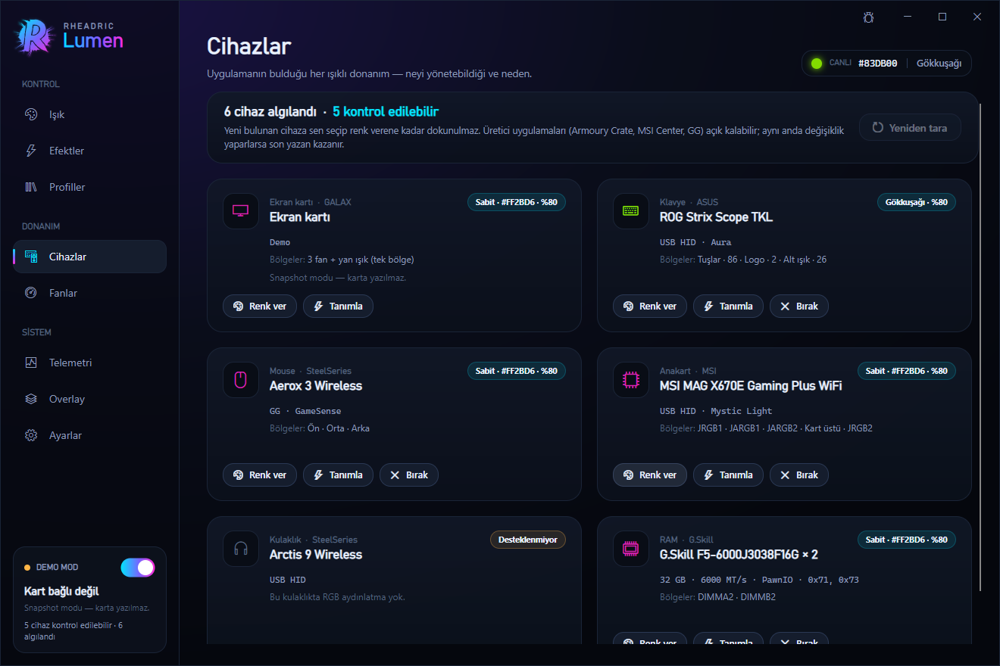 | 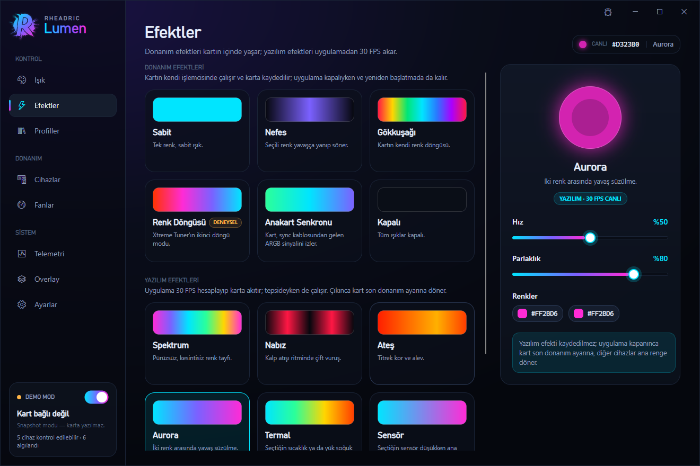 | 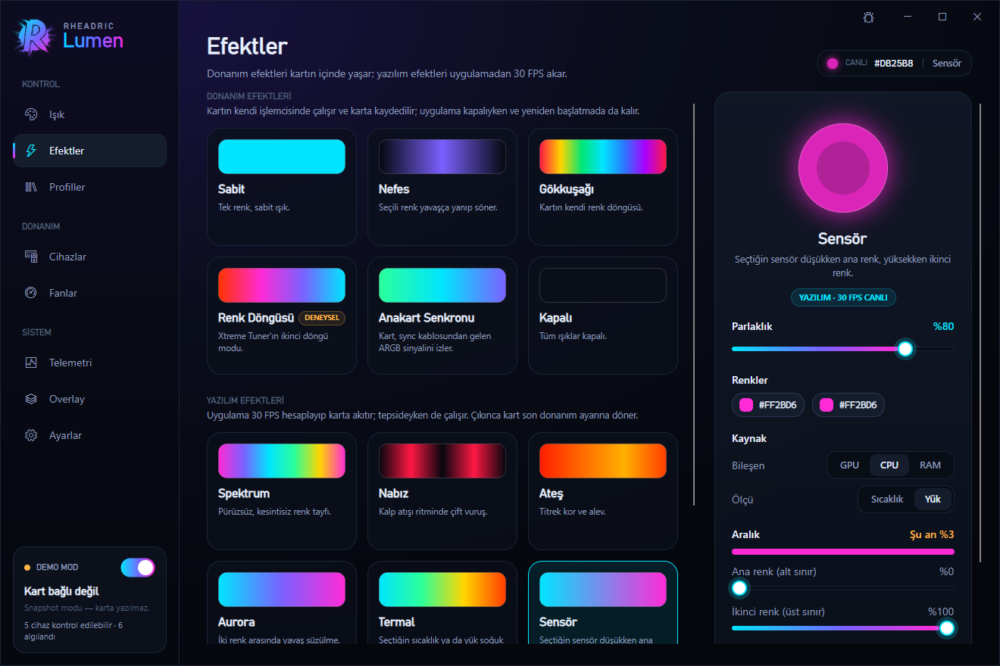 |  |

| Ekran kartı fan eğrisi | 0 dB | Anakart fanları | Telemetri |
|---|---|---|---|
| 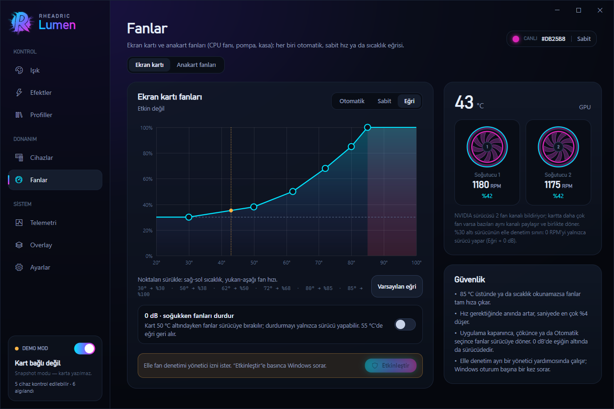 |  | 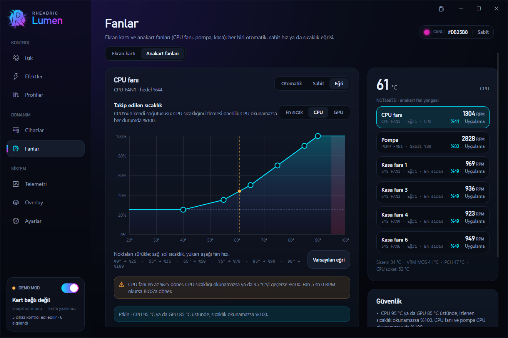 | 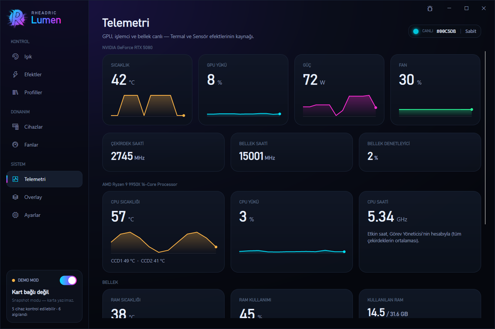 |

| Overlay ayarları | Yan ekranda serbest konum | Ekranda (şerit, arka plansız) | Ekranda (sütunlar) |
|---|---|---|---|
| 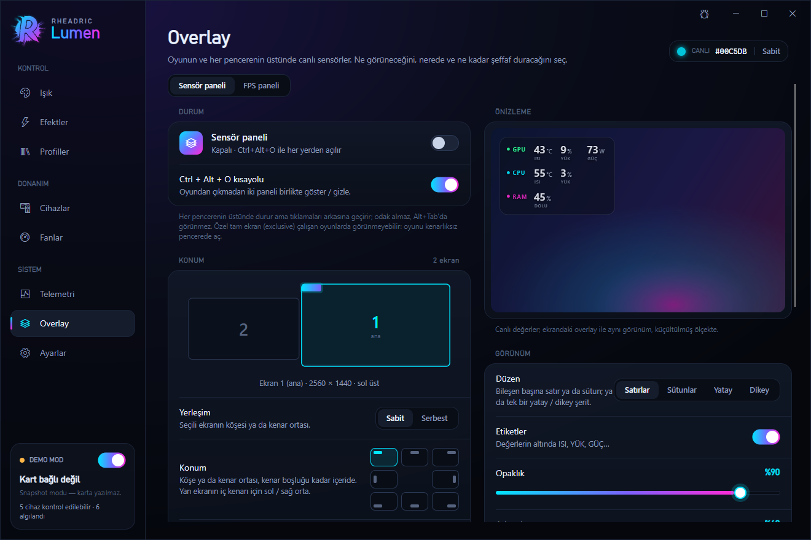 | 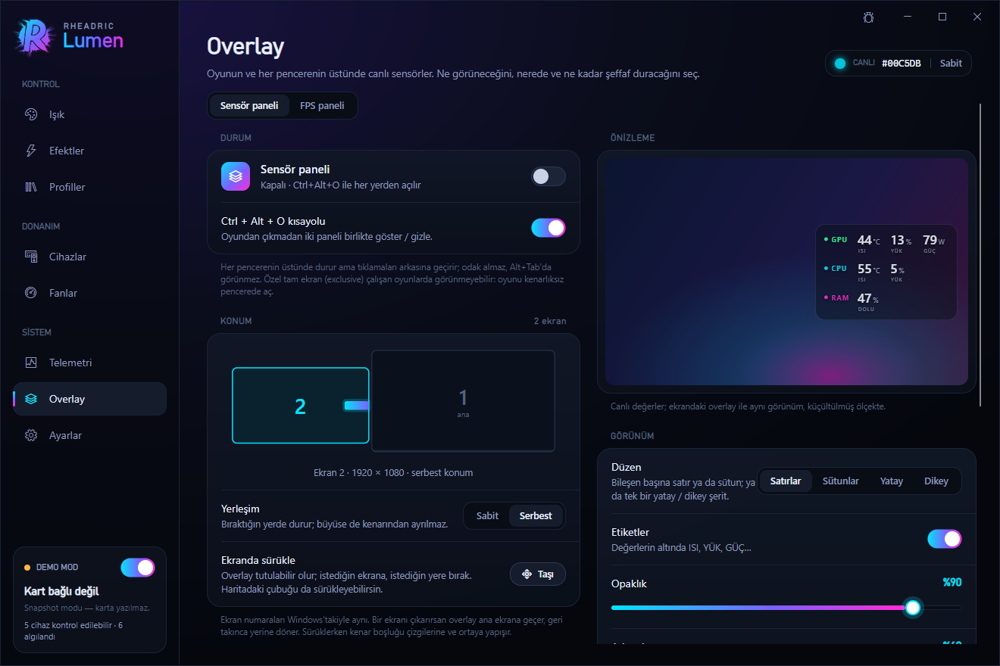 |  | 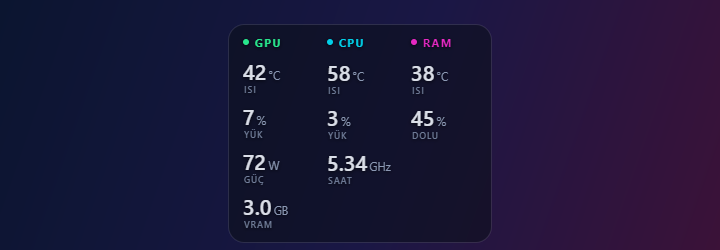 |

| FPS paneli ayarları | Ekranda FPS paneli | Dikey şerit (FPS ile) | Ayarlar ve dil |
|---|---|---|---|
| 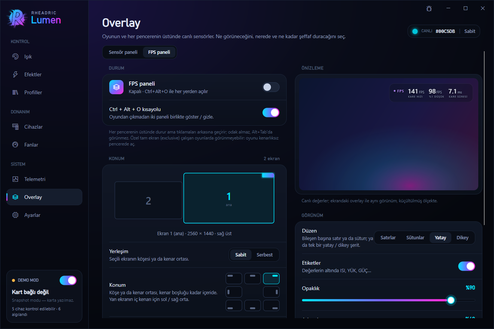 |  | 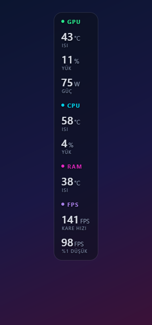 | 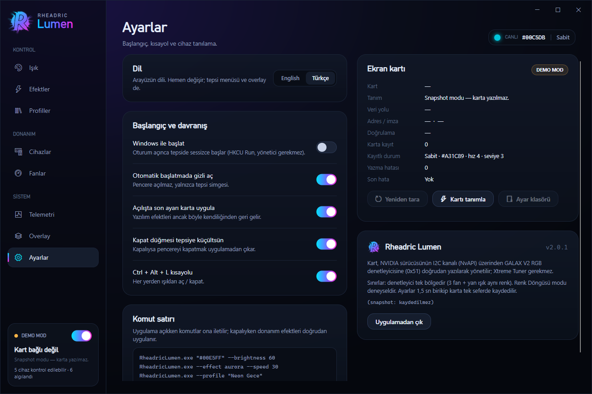 |

---

<a name="tr-donanim"></a>

## Desteklenen donanım

Aksi yazmıyorsa aşağıdakiler gerçek donanımda denendi. Sende başka bir şey mi var?
Tam model adıyla [bir issue aç](https://github.com/rheadricc/RheadricLumen/issues).

### Işık

| Cihaz | Nasıl | Not |
|---|---|---|
| **GALAX GeForce RTX 5080** 1-Click OC 3X | NVIDIA sürücüsü (kartın RGB denetleyicisi, I²C) | Denendi. Işık için Xtreme Tuner'a gerek kalmaz |
| **GALAX GeForce RTX 5070 Ti** EX Gamer 1-Click OC | aynı | Bilinen kimliklerden eklendi, henüz denenmedi |
| **ASUS ROG Strix Scope TKL** klavye | USB, Aura direct modu | Denendi, tuşlar ve alt ışık. Klavyeye kalıcı bir şey kaydedilmez |
| **SteelSeries Aerox 3 Wireless** mouse | SteelSeries GG (GameSense) | Denendi. **GG açık olmalı**; uygulama kapanınca mouse GG'deki ayarına döner |
| **MSI Mystic Light** anakartlar (`0DB0:0076`, ör. X670E Gaming Plus WiFi) | USB | Denendi. JRGB, JARGB ve kart üstü LED'ler; anakarta kalıcı bir şey kaydedilmez |
| ENE RGB denetleyicili **RAM** (`AUDA0-E6K5-0101`), ör. G.Skill DDR5 `F5-6400J3239G16G` | SMBus, [PawnIO](https://pawnio.eu) üzerinden | AMD'de (X670E) denendi. Bkz. [RAM ışığı](#tr-ram) |
| SteelSeries Arctis 9 | | Listelenir; RGB'si yok |

Ekran kartın tanınmazsa uygulama ona **hiçbir şey yazmaz** ve kartı demo modunda gösterir; diğer cihazlar, fanlar ve
overlay yine çalışır. Klavye, mouse, anakart ve RAM yalnızca sabit renk kabul eder; bu yüzden onlardaki hareketli
efektler uygulama tarafından kare kare çizilir ve uygulama açıkken çalışır (tepside çalışmaya devam eder).

### Fanlar

| Fanlar | Nasıl | Not |
|---|---|---|
| **Ekran kartı fanları** | NVIDIA sürücüsü | Yukarıdaki RTX 5080'de denendi |
| **Anakart fanları**: **Nuvoton NCT6687D**'li MSI 400–700 serisi anakartlarda CPU fanı, pompa, sistem fanları (ör. X570, B650, X670E) | Fan çipi, PawnIO üzerinden | X670E'de denendi. MSI 800 serisi farklı bir çip revizyonu kullanır ve reddedilir. Bkz. [Anakart fanları](#tr-anakart-fanlari) |

### Sensörler

GPU değerleri NVIDIA sürücüsünden; CPU yükü, saat hızı ve RAM kullanımı Windows'tan gelir, her bilgisayarda çalışır.
CPU (AMD Ryzen) ve DDR5 modül sıcaklıkları PawnIO ister. FPS her oyunda çalışır ve yönetici izni ister.

<a name="tr-ram"></a>

### RAM ışığı

RAM ışığı anakartın SMBus hattındadır ve Windows oraya yalnızca bir çekirdek sürücüsünün erişmesine izin verir.
Rheadric Lumen kendi sürücüsünü getirmez; OpenRGB ve LibreHardwareMonitor'ın da kullandığı imzalı, açık kaynak
**[PawnIO](https://pawnio.eu)**'yu kullanır.

1. PawnIO'yu bir kez kur: [PawnIO_setup.exe](https://github.com/namazso/PawnIO.Setup/releases/latest) (geliştiricisinin GitHub'ından).
2. Rheadric Lumen'i aç, **Cihazlar**'da RAM kartındaki **Renk ver**'e bas ve bir renk seç.
3. Windows **her açılışta bir kez** yönetici izni ister: RAM'e yazma işi, uygulamayla birlikte kapanan küçük bir
   yardımcı süreçte (`RheadricLumen.exe --ram-host`) yapılır.

Bilerek yaptıkları ve yapmadıkları:

- Yalnızca RGB denetleyicilerine (SMBus `0x70`–`0x77`) yazar; o da yalnızca ENE imzasıyla cevap veren ve gerçek
  modüllerde denenmiş bir denetleyici sürümüne sahip olanlara. Modüllerin SPD hub'ları (`0x50`–`0x57`) yalnızca
  *okunabilir*, o da yalnızca sıcaklık sensörü için gereken altı yazmaç; yardımcı onlara giden her başka işlemi reddeder.
- Her işlem MSI Center, OpenRGB ve HWiNFO'nun kullandığı sistem genelindeki SMBus kilidini alır; onlarla çakışmaz.
- Yalnızca renkleri ve "direct" anahtarını yazar. Modüllere bir şey kaydedilmez, adresleri hiç değişmez: bilgisayarı
  tamamen kapatıp açmak kendi ışıklarını geri getirir.
- **Bırak**, modüllerin uygulama onlara ilk dokunmadan önceki renklerini geri yazar.
- **MSI Center** açıksa RAM'i Mystic Light'ın senkronundan çıkar, yoksa iki program da ona yazar.

PawnIO yoksa RAM listelenir ama ona yazılmaz.

<a name="tr-anakart-fanlari"></a>

### Anakart fanları

Aynı PawnIO sürücüsü (imzalı `LpcIO` modülü) uygulamanın anakartın fan çipine ulaşmasını sağlar.

1. **Fanlar → Anakart fanları**'nı aç. Bu, donanım sensörlerini açar (her açılışta bir kez yönetici izni; RAM'le aynı
   yardımcı).
2. Sağdaki listeden bir fan seç (CPU fanı, pompa ya da bir kasa fanı), sonra **Otomatik** (BIOS eğrisi), **Sabit** ya
   da **Eğri** ve eğrinin hangi sıcaklığı izleyeceği. Her fan kendi ayarını tutar; tek düğme bunu bütün kasa
   fanlarına kopyalar.

- CPU fanı %25'in, pompa %50'nin altına inmez; CPU sıcaklığı okunamazsa ikisi de %100 çalışır.
- Uygulama sürerken 5 saniye 0 RPM okuyan fan, sen ayarını değiştirene kadar BIOS'a döner.
- Uygulama kapanır, çöker ya da 10 saniye boyunca istekte bulunmazsa fanlar BIOS'a döner. Yardımcının kendisi
  öldürülürse bir sonraki, her şeyden önce onları geri verir.
- Hızı değişmeyen fan PWM kontrollü değildir (3 pinli ya da bir hub üzerinde). **MSI Center**'ın fan kontrolü açıksa
  aynı soketler için uygulamayla çekişir: fanları ikisinden birinde **Otomatik**'te bırak.

---

<a name="tr-kullanim"></a>

## Kullanım

1. **Işık**: **Hedef cihaz**'da **Tümü**'nü ya da istediğin cihazları seç, sonra bir renk seç. Hemen uygulanır.
2. **Efektler**: bir animasyon ve hızını seç. Yazılım efektleri seçili bütün cihazlara gider; donanım efektleri
   ekran kartının kendisinde çalışır.
3. **Cihazlar**: bulunan her şey, neyin kontrol edilebildiği ve neden. **Renk ver** cihazı devralır, **Tanımla** onu
   yakıp söndürür, **Bırak** kendi programına geri verir, **Yeniden tara** baştan arar.
4. **Fanlar → Ekran kartı**: **Otomatik**, **Sabit** ya da **Eğri**, sonra **Etkinleştir**. Windows bir kez yönetici izni
   ister, çünkü NVIDIA sürücüsü fan hızını yalnızca yetkili bir süreçten kabul eder.
   **Fanlar → Anakart fanları**: bkz. [Anakart fanları](#tr-anakart-fanlari).
5. **Overlay**: **Sensör paneli**'ni ya da **FPS paneli**'ni aç; değerleri, düzeni ve konumu seç. Elle yerleştirmek
   için **Taşı**'ya bas, istediğin ekrana sürükle ve **Bitti** de.
6. **Profiller**: o anki görünümü bir adla kaydet, **Uygula** ile geri getir.
7. **Ayarlar → Dil**: **English** ya da **Türkçe**. Arayüz, tepsi menüsü ve overlay anında değişir.
8. Pencereyi kapatmak uygulamayı tepside bırakır. Çıkmak için: tepsi simgesi → **Çıkış**.

### Bilmekte fayda var

- **Üretici programları kurulu kalabilir** (Xtreme Tuner, Armoury Crate, MSI Center, SteelSeries GG, OpenRGB); ama iki
  program aynı cihaza yazarsa son yazan kazanır. Armoury Crate profil değiştirirken kendi klavye efektini yeniden
  uygular; MSI Center açılırken kendi anakart profilini yükler.
- **GALAX kartında tek renk.** Denetleyicisi üç fanı ve yan ışığı tek renkten sürer; Fan 1/2/3 seçmek de bütün fanları
  boyar. Uygulama bu durumda haber verir.
- Penceredeki donanım animasyonu önizlemesi yaklaşıktır; kartın kendisi geri okunamaz.
- **Ekran kartı fanları, hızı uygulama verdiğinde %30'un altına inemez** (NVIDIA sınırı) ve onları yalnızca sürücü
  durdurabilir: 0 dB fanları ona bırakır, o da kart gerçekten boştayken durdurur.
- **Overlay, özel tam ekran (exclusive) oyunların üstünde görünmeyebilir**: oyunu kenarlıksız pencerede aç.
- **Windows 10'da pencere modundaki Vulkan/OpenGL oyunlarının FPS'i** görünmeyebilir: kareleri oyun değil bir sistem
  süreci sunar (PresentMon'da da aynı sınır var). Direct3D oyunları ve tam ekran oyunlar ölçülür.

---

<a name="tr-komut"></a>

## Komut satırı

```text
RheadricLumen.exe "#00E5FF" --brightness 60     sabit renk (karta kaydedilir)
RheadricLumen.exe --effect aurora --speed 30    efekt: static, breathing, rainbow, cycle, sync, off,
                                                spectrum, pulse, fire, aurora, thermal, load, audio
RheadricLumen.exe --profile "Neon Gece"         profil uygula
RheadricLumen.exe off | on | toggle             ışıkları kapat / aç / değiştir
RheadricLumen.exe --overlay on|off|toggle       sensör overlay'i (gerekirse uygulamayı tepside başlatır)
RheadricLumen.exe --sensors                     bütün sensörleri bir kez yazdır (CPU/RAM sıcaklığı yönetici izni ister)
RheadricLumen.exe --fps [saniye]                ekrana çizen her uygulamanın FPS'ini yazdır (5 sn; yönetici izni ister)
RheadricLumen.exe --lang en|tr                  yalnızca bu çalıştırmanın dili (ayar değişmez)
RheadricLumen.exe --exit                        açık uygulamayı düzgünce kapat
RheadricLumen.exe --list | --help
```

Uygulama zaten açıksa komut ona iletilir ve Işık sayfasında seçili cihazlara gider. PowerShell'de çıktıyı görmek için
sonuna `| Out-Host` ekle.

---

<a name="tr-kaldirma"></a>

## Kaldırma

1. **Ayarlar** → **Windows ile başlat**'ı kapat.
2. Tepsi simgesi → **Çıkış**. Fanlar kendiliğinden sürücüye / BIOS'a döner.
3. **Rheadric Lumen** klasörünü ve ayar klasörü `%APPDATA%\RheadricLumen`'i sil.
4. PawnIO'yu yalnızca bu uygulama için kurduysan *Ayarlar → Uygulamalar*'dan diğer programlar gibi kaldır.

Uygulamanın kendisi sürücü ya da servis kurmaz. Otomatik başlatma açıkken exe'yi zaten sildiysen
`HKEY_CURRENT_USER\Software\Microsoft\Windows\CurrentVersion\Run` altındaki `RheadricLumen` değerini sil.

---

<a name="tr-sss"></a>

## SSS

**Ekran kartıma zarar verebilir mi?**
Kartın yazılımına (firmware) ya da BIOS'una dokunmaz; Xtreme Tuner'ın yazdığı RGB denetleyici yazmaçlarının aynısına
yazar. Art arda renk değişiklikleri (örneğin renk çarkını sürüklemek) kaydedilmeden önce toplanır; yazılım efektleri
karta hiç kaydedilmez.

**RAM'ime zarar verebilir mi?**
RGB programlarının RAM'e zarar verdiği bilinen yol, yanlış SMBus cihazına (SPD çipine) yazmak ya da hatta başka bir
programla yarışmaktır. RAM yardımcısı SPD aralığına hiç yazamaz, ortak SMBus kilidini alır, denenmemiş denetleyici
sürümlerini reddeder ve modüllere hiçbir şey kaydetmez. Bkz. [RAM ışığı](#tr-ram).

**Fan kontrolü güvenli mi?**
Güvenlik kuralları pencerede değil, yetkili yardımcı süreçlerin kendisinde çalışır: ısınınca ya da sıcaklık
okunamazsa %100, CPU fanı ve pompa için en düşük hız, yavaş iniş; Otomatik'i seçince, çıkınca ya da uygulama çökünce
yeniden sürücü / BIOS kontrolü. Kayıtlar: `%APPDATA%\RheadricLumen\fanhost.log` (ekran kartı) ve `ramhost.log` (anakart).

**Sürekli açık kalması gerekir mi?**
Yalnızca yazılım efektleri, klavye / mouse / anakart / RAM'deki hareketli efektler, Otomatik dışındaki fan modları ve
overlay için. Ekran kartındaki donanım efektleri uygulama kapanınca da kalır; RAM, klavye ve anakart bilgisayar
kapanana kadar son renklerini korur.

**Mouse'um listede yok.**
Önce SteelSeries GG'yi aç, sonra Cihazlar sayfasında **Yeniden tara**'ya bas.

**Dili nasıl değiştiririm?**
**Ayarlar → Dil → English / Türkçe** (İngilizce arayüzde **Settings → Language**). Anında değişir. İlk kurulum
İngilizce açılır.

---

<a name="tr-gizlilik"></a>

## Gizlilik

İnternet erişimi yok, telemetri yok, güncelleme kontrolü yok. Tek ağ trafiği, SteelSeries GG'nin kendi bilgisayarındaki
yerel GameSense sunucusuna (`127.0.0.1`) gider, o da yalnızca bir SteelSeries cihazı kullanılırken.

---

<a name="tr-lisans"></a>

## Lisans

Kişisel kullanım için ücretsiz. Yeniden dağıtma, satma ve tersine mühendislik yasaktır: bkz.
[LICENSE.txt](LICENSE.txt). Katkılar ve üçüncü taraf bildirimleri: [THIRD-PARTY-NOTICES.txt](THIRD-PARTY-NOTICES.txt).

GALAX, GALAX'ın (Galaxy Microsystems Ltd.) ticari markasıdır. NVIDIA ve GeForce, NVIDIA Corporation'ın; ASUS, ROG, Aura
ve Armoury Crate, ASUSTeK Computer Inc.'in; MSI, Mystic Light ve MSI Center, Micro-Star International'ın; SteelSeries,
GG ve GameSense, SteelSeries ApS'in; G.Skill, G.Skill International'ın ticari markalarıdır. Bu projenin hiçbiriyle
bağlantısı yoktur.

---

© 2026 Batuhan Çakır (Rheadric)
