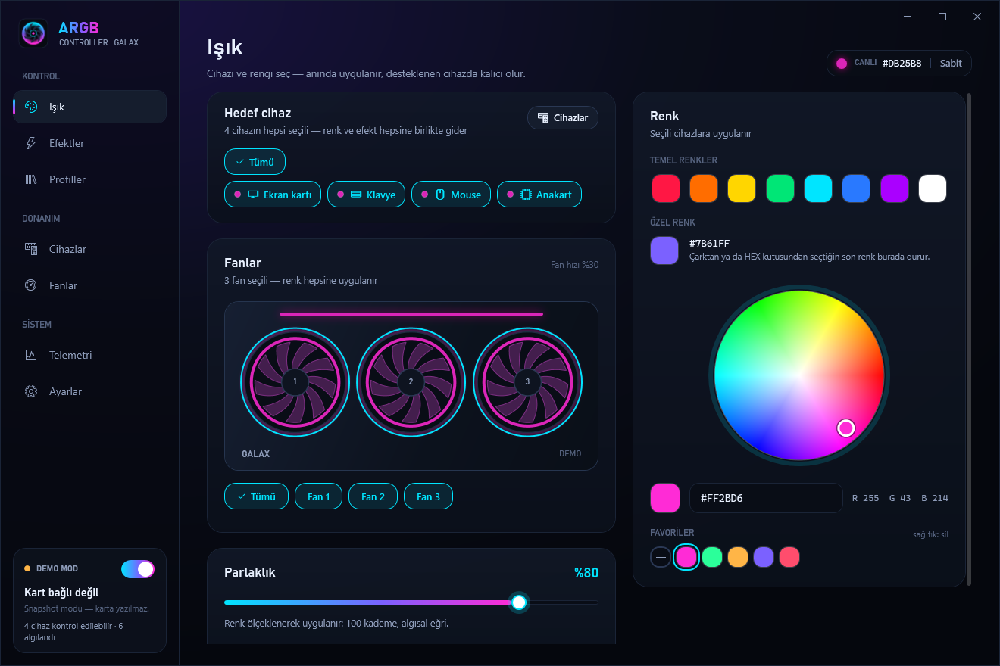
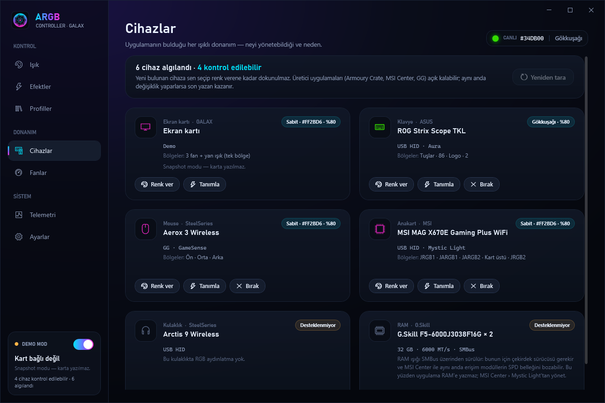
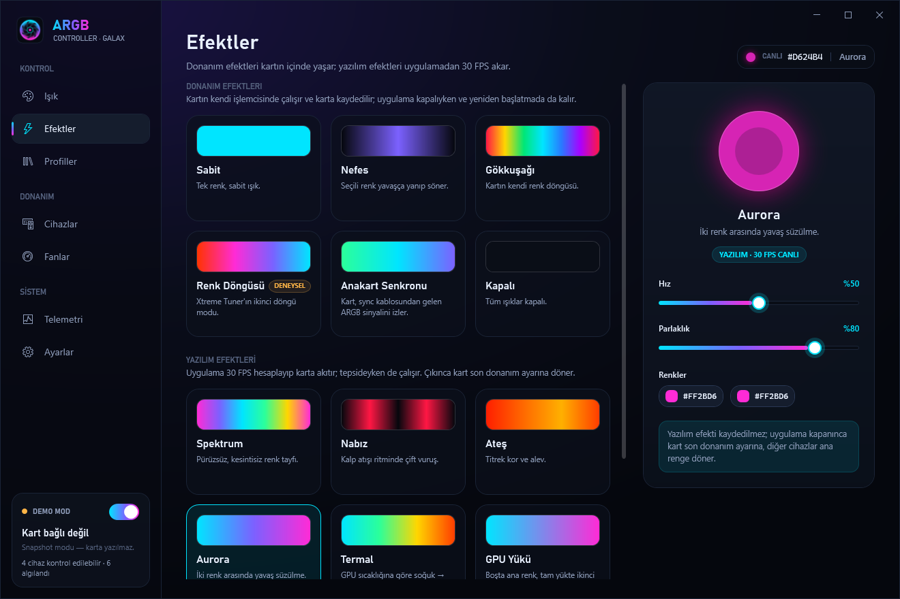
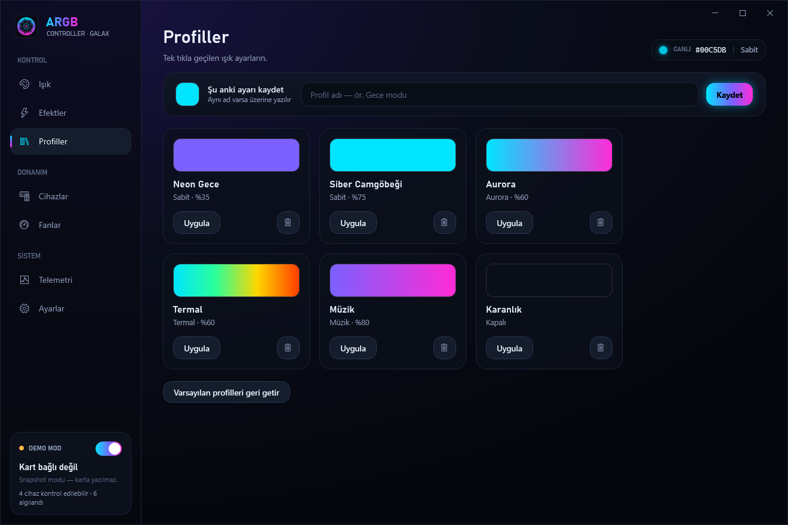
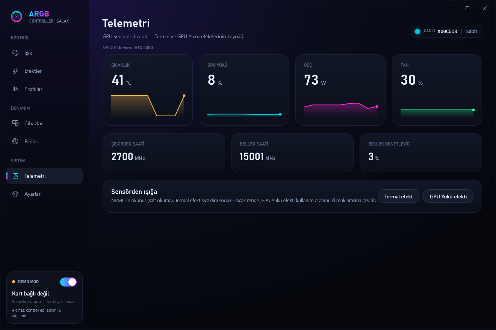

<div align="center">

# ARGB Controller for Galax

**Control the lighting of GALAX RTX 50 graphics cards without Xtreme Tuner, plus your keyboard,
mouse and motherboard lighting and your GPU fans, from one small window.**

<a href="https://github.com/rheadricc/ARGB-Controller-for-Galax/releases/download/v1.0.0/ARGB-Controller-for-Galax-v1.0.0-win64.zip"></a>




</div>

---

## Download

**The program is right here in this repository:** `ArgbGalax.exe` is the whole app (one file, under 1 MB).
Get it either way:

1. the green **Download** button above →
   [`ARGB-Controller-for-Galax-v1.0.0-win64.zip`](https://github.com/rheadricc/ARGB-Controller-for-Galax/releases/download/v1.0.0/ARGB-Controller-for-Galax-v1.0.0-win64.zip) (~517 KB), or
2. the green **`<> Code`** button at the top of this page → **Download ZIP**.

Then **extract the zip** (right-click → *Extract All…*), put `ArgbGalax.exe` somewhere permanent
(for example `%LOCALAPPDATA%\Programs\ARGB Controller for Galax`) and double-click it.
Older versions and release notes: [Releases](https://github.com/rheadricc/ARGB-Controller-for-Galax/releases).

> **Needs the .NET 10 Desktop Runtime.** If it's missing, Windows shows a dialog with a download link
> on first start. Direct link: [.NET 10 → *.NET Desktop Runtime* → Windows x64](https://dotnet.microsoft.com/download/dotnet/10.0).

> **Windows SmartScreen warning?** The exe is not digitally signed yet, so Windows shows
> *"Windows protected your PC"* on first run. Click **More info → Run anyway**.

> **The interface is in Turkish.** The labels used below are given in Turkish with a translation.

---

## What it does

GALAX cards ship with Xtreme Tuner for their RGB. This app talks to the card's RGB controller
directly through the NVIDIA driver instead, and while it's at it, drives the other lit hardware
in your PC and the GPU fans.

| | |
|---|---|
| 🎨 **Card lighting** | Color wheel, HEX input, 8 base colors, a custom slot and favorites. Brightness 0–100 |
| ✨ **Hardware effects** | Static, Breathing, Rainbow, Color cycle, Motherboard sync, Off. They run on the card itself and stay after a reboot, even with the app closed |
| 🌈 **Software effects** | Spectrum, Pulse, Fire, Aurora, Thermal (follows GPU temperature), GPU load, Music (reacts to what you hear), streamed at 30 FPS from the tray |
| ⌨️ **Other devices** | Finds your keyboard, mouse and motherboard lighting on start. Color one, several or all of them at once; each keeps its own setting |
| 🌀 **GPU fans** | Auto (driver), Fixed % or a drag-to-edit temperature curve, with live RPM |
| 🛡️ **Fan safety** | 100 % above 85 °C or if the sensor can't be read; fans go back to the driver when you pick Auto, quit, or the app crashes |
| 💾 **Profiles** | 6 ready-made looks; save, overwrite and delete your own |
| 📈 **Telemetry** | Temperature, load, power, fan and clock speeds (read only) |
| ⚡ **Quick control** | Tray menu, **Ctrl+Alt+L** toggles all lights from anywhere, optional start with Windows, command line |

| Devices | Fan curve |
|---|---|
|  |  |

| Effects | Profiles | Telemetry |
|---|---|---|
|  |  |  |

---

## Supported hardware

### Graphics cards

| Card | Status |
|---|---|
| GALAX GeForce RTX 5080 1-Click OC 3X | Tested on a real card |
| GALAX GeForce RTX 5070 Ti EX Gamer 1-Click OC | Added from known IDs, not tested yet |

If your card isn't recognised the app **writes nothing to it** and shows the card in demo mode;
the other devices and the fan page still work. Fan control uses the NVIDIA driver and has only been
tested on the RTX 5080 above. Have another GALAX RTX 50 card?
[Open an issue](https://github.com/rheadricc/ARGB-Controller-for-Galax/issues) with its exact model name.

### Other devices

| Device | How | Notes |
|---|---|---|
| ASUS ROG Strix Scope TKL keyboard | USB, Aura direct mode | Tested. The color lives in the keyboard's memory, nothing is saved to it permanently |
| SteelSeries Aerox 3 Wireless mouse | SteelSeries GG (GameSense) | Tested. **SteelSeries GG must be running**; the mouse returns to your GG setting when the app quits |
| MSI Mystic Light motherboards (`0DB0:0076`, e.g. X670E Gaming Plus WiFi) | USB | Tested. JRGB, JARGB and onboard LEDs; nothing is saved to the board permanently |
| SteelSeries Arctis 9 | | Listed; it has no RGB |
| DDR5 RAM lighting | | **Listed but deliberately not written.** RAM RGB needs a kernel driver, and writing it while MSI Center does the same can corrupt the modules' SPD. Use your board's own software for RAM |

Keyboard, mouse and motherboard only accept a static color, so animated effects on them are drawn
frame by frame by the app and only run while it's open (it keeps running in the tray).

---

## How to use it

1. **Işık** *(Light)*: under **Hedef cihaz** *(Target device)* pick **Tümü** *(All)* or the devices you
   want, then choose a color. It's applied immediately.
2. **Efektler** *(Effects)*: pick an animation and its speed.
3. **Cihazlar** *(Devices)*: everything that was found, what can be controlled and why.
   **Renk ver** *(Set color)* takes a device over, **Tanımla** *(Identify)* flashes it,
   **Bırak** *(Release)* hands it back to its own software.
4. **Fanlar** *(Fans)*: **Otomatik** *(Auto)*, **Sabit** *(Fixed)* or **Eğri** *(Curve)*, then
   **Etkinleştir** *(Enable)*. Windows asks for administrator permission once, because the NVIDIA driver
   only accepts fan speeds from an elevated process.
5. Closing the window keeps the app in the tray. To quit: tray icon → **Çıkış** *(Exit)*.

A newly found device is never touched until you give it a color yourself.

### Good to know

- **Xtreme Tuner, OpenRGB, Armoury Crate, MSI Center and GG can stay installed**, but if two programs
  write to the same device the last one wins. Armoury Crate re-applies its own keyboard effect when it
  switches profiles; MSI Center loads its own motherboard profile when it starts.
- **One color for the whole card.** The GALAX controller drives all three fans and the side light from a
  single color, so the Fan 1/2/3 selection still colors every fan. The app tells you when that happens.
- The preview of hardware animations in the window is an approximation; the card itself can't be read back.

---

## Command line

```text
ArgbGalax.exe "#00E5FF" --brightness 60     static color (saved to the card)
ArgbGalax.exe --effect aurora --speed 30    effect: static, breathing, rainbow, cycle, sync, off,
                                            spectrum, pulse, fire, aurora, thermal, load, audio
ArgbGalax.exe --profile "Neon Gece"         apply a profile
ArgbGalax.exe off | on | toggle             lights off / on / toggle
ArgbGalax.exe --exit                        close the running app cleanly
ArgbGalax.exe --list | --help
```

If the app is already running the command is passed to it. In PowerShell add `| Out-Host` to see the output.

---

## Uninstall

1. **Ayarlar** *(Settings)* → turn **Windows ile başlat** *(Start with Windows)* off.
2. Tray icon → **Çıkış** *(Exit)*. Fans go back to driver control automatically.
3. Delete `ArgbGalax.exe` and the settings folder `%APPDATA%\ArgbGalax`.

The app installs no drivers and no services. If you already deleted the exe while autostart was on,
remove the `ArgbGalax` value under `HKEY_CURRENT_USER\Software\Microsoft\Windows\CurrentVersion\Run`.

---

## FAQ

**Can this damage my card?**
It doesn't touch the card's firmware or BIOS. It writes the same RGB controller registers as Xtreme Tuner.
Repeated color changes (for example dragging the color wheel) are batched before anything is saved, and
software effects are never saved to the card at all.

**Is fan control safe?**
The safety rules run in the elevated fan helper itself, not in the window: 100 % above 85 °C or without a
temperature reading, a slow ramp down, and automatic driver control again when you choose Auto, quit or the
app crashes. The fans never go below the driver's own minimum. A log is kept in `%APPDATA%\ArgbGalax\fanhost.log`.

**Does it need to run all the time?**
Only for software effects, animated effects on the keyboard/mouse/motherboard, and fan modes other than Auto.
Hardware effects on the card stay after the app is closed.

**My mouse isn't listed.**
Start SteelSeries GG first, then press **Yeniden tara** *(Rescan)* on the Devices page.

---

## Privacy

No internet access, no telemetry, no update checks. The only network traffic is to SteelSeries GG's local
GameSense server on your own PC (`127.0.0.1`), and only when a SteelSeries device is in use.

---

## License

Free for personal use. Redistribution, resale and reverse engineering are not permitted:
see [LICENSE.txt](LICENSE.txt). Credits and third-party notices: [THIRD-PARTY-NOTICES.txt](THIRD-PARTY-NOTICES.txt).

GALAX is a trademark of GALAX (Galaxy Microsystems Ltd.). NVIDIA and GeForce are trademarks of NVIDIA Corporation.
ASUS, ROG, Aura and Armoury Crate are trademarks of ASUSTeK Computer Inc. MSI, Mystic Light and MSI Center are
trademarks of Micro-Star International. SteelSeries, GG and GameSense are trademarks of SteelSeries ApS.
G.Skill is a trademark of G.Skill International. This project is not affiliated with any of them.

---

## Türkçe

GALAX RTX 50 serisi ekran kartlarının ışıklarını **Xtreme Tuner olmadan** yöneten küçük bir Windows uygulaması.
Aynı pencereden klavye, mouse ve anakart ışıklarını da değiştirir, ekran kartı fanlarına sabit hız ya da sıcaklık
eğrisi verir. Arayüz Türkçedir.

- **İndir:** yukarıdaki yeşil **Download** düğmesi → zip'i çıkar → `ArgbGalax.exe`. Kurulum yok.
  [.NET 10 Desktop Runtime](https://dotnet.microsoft.com/download/dotnet/10.0) gerekir.
- *"Windows bilgisayarınızı korudu"* uyarısı çıkarsa: **Ek bilgi → Yine de çalıştır** (exe henüz imzalı değil).
- Fan modları (Sabit / Eğri) ilk kullanımda bir kez yönetici izni ister. 85 °C üstünde ya da sensör okunamazsa
  fanlar %100'e çıkar; uygulama kapanınca ya da çökünce fanlar sürücüye geri döner.
- RAM ışığı bilerek yazılmaz (çekirdek sürücüsü ister, MSI Center ile çakışırsa modüllere zarar verebilir).
- Kaldırmak için: Ayarlar → "Windows ile başlat" kapat → tepsiden Çıkış → exe'yi ve `%APPDATA%\ArgbGalax` klasörünü sil.

© 2026 Batuhan Çakır (Rheadric)
